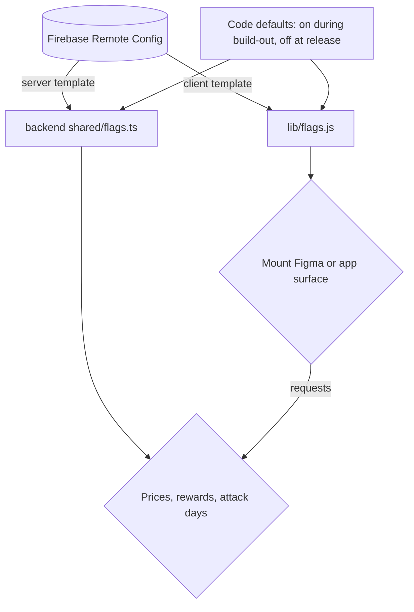
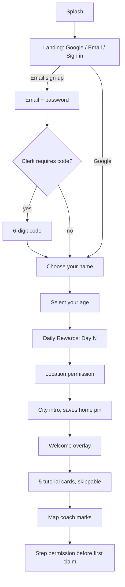
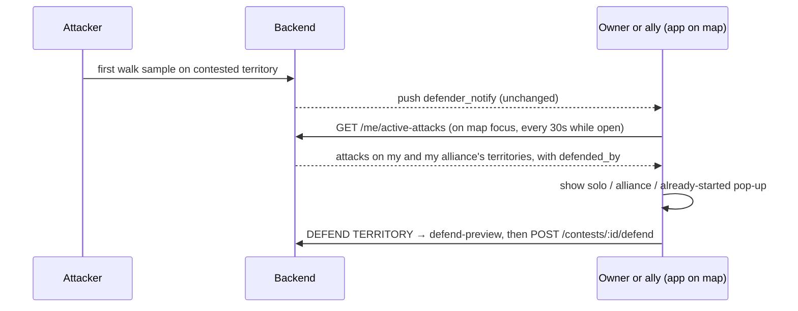
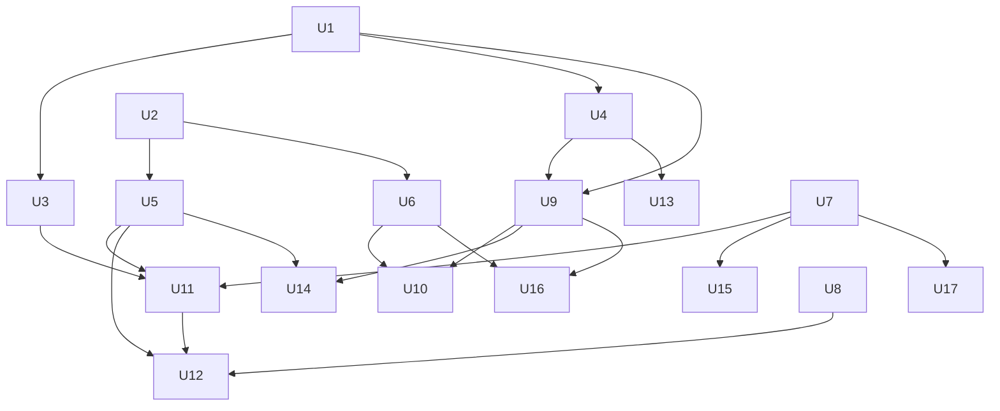

# feat: Figma Final parity with flag-gated app-only features

**Target repos:** `dominia` (mobile, this repo) and `dominia-backend` (sibling directory). Paths are repo-relative and prefixed `backend:` when they live in `dominia-backend`.

## Summary

Bring the app to parity with Figma's "Final" page: deliver the 38 screens and states listed as missing in the origin (some extend partly built screens), reshape the other partly built ones, and move to a Gold-only economy. Every app-only feature stays in the code behind its own Firebase Remote Config flag, which is off once the work is complete. The backend reads the same flags so prices, rewards and attack rules match what the app shows.

## Problem Frame

Figma is the product's source of truth (see origin: Key decisions). The app has drifted: it runs a four-resource economy, different tabs, a heavier territory sheet, and several systems Figma never drew, while 18 Figma cases have no equivalent at all. The team wants the Figma product shipped without deleting the extra systems, so any of them can be switched back on without an app release.

---

## Requirements

**Missing screens and states** (carried from origin, IDs unchanged)
- R1–R8. Onboarding: splash, Google/Email landing, age, Daily Rewards, city intro, welcome overlay, five tutorial cards, feature explainer cards.
- R9–R15. Map: avatar, Gold Economy Panel, territory search, five-control side rail, solo and alliance defend pop-ups, "already started" state.
- R16–R20. Challenge: live map with polygon fill, ATTACKING/DEFENDING headers, recenter, DEFEAT and VICTORY overlays.
- R21–R25. Missions: Your Missions with refresh countdown, LOCK, locked and rewards-ready states, Alliance Missions with the no-alliance variant.
- R26–R31. Alliance: search, richer list rows, detail pop-up, member-view header and members, Rules on create, name validation.
- R32–R36. Profile: accordion, Resource Balance, Statistics, Units setting, Edit Profile.
- R37–R38. Leaderboards with Territories/Distance, SOLO/ALLIANCE, podium and pinned position; Events placeholder tab.

**Flags**
- R39. Each app-only feature listed in the origin has its own Remote Config flag, default off after the final release (on during build-out).
- R40. With every flag off, a new player completes every Figma flow without meeting a screen, control or currency Figma lacks, apart from platform necessities.
- R41. Turning a flag on restores the app's current version of that feature without an app release.
- R42. The backend applies the same flag values the app sees, and a player cannot change them from the client.

**Economy**
- R43. With `multi_resource_economy` off, Gold is the only spendable or earnable resource. Player level and XP remain.
- R44. Prices and rewards are server-configurable: attack 8/20/45/80 Gold by tier, defence 10 Gold, missions 10/20/40 Gold, daily reward 60 Gold, claim costs unchanged.

---

## Key Technical Decisions

- **Remote Config on both sides with identical parameter keys.** The app uses `@react-native-firebase/remote-config`. The backend uses `firebase-admin` server templates, which it already initialises in `backend:src/shared/firebase.ts`. A client header was rejected because it would let a player switch economies (R42).
- **One flag module per side, read through a single accessor.** App: `lib/flags.js` with a `useFlag(name)` hook and a synchronous `getFlag(name)`. Backend: `backend:src/shared/flags.ts` with `getFlag(name)` backed by a cached template that refreshes every 5 minutes. Feature code never touches Firebase directly.
- **Code defaults are `true` (today's behaviour) during the build-out, and flip to `false` in the release that completes Phase 3.** Until then, a fetch failure or offline first launch shows today's app, so no surface disappears before its Figma replacement exists. The final release sets every default to `false`, after which failures resolve to Figma behaviour (R40). The flip is a one-line change to each defaults map and is the last step of U17.
- **App flag values apply immediately, with two guards.** The app awaits `remoteConfig().ensureInitialized()` (300 ms timeout) before the first render so it starts on the last activated values, then fetches and activates in the background. A change that lands while ActiveClaim is mounted is held until the challenge ends. A `legacy_tabs` change resets navigation to the Map tab.
- **Backend keeps last-known-good values.** On a refresh failure the backend keeps serving the last successfully fetched template and logs a warning; code defaults apply only on a cold start with no template.
- **Prices reach the app through Remote Config.** The economy table is one Remote Config JSON parameter read by both the app and the backend. `lib/formulas.js` reads it through `lib/flags.js`, and its current constants become the code defaults.
- **Flags swap whole surfaces, not individual widgets.** Where Figma replaces an app surface (territory card vs sheet, Missions vs Activity, challenge map vs ring), the flag picks which component mounts. The old component stays untouched. Edits to old code are limited to mounting conditions.
- **Gold-only pricing is a backend branch inside existing cost functions.** `CONTEST_IRON_COST`, `STONE_DEFENCE_COST` and `RESOURCE_EARN` keep their values for flag-on mode. New Gold tables sit alongside them, and the cost functions select a table by flag. Numbers come from the shared economy parameter (R44).
- **Gold defence is a mandatory 10 Gold fee.** With `multi_resource_economy` off every defence costs 10 Gold and the defender walks at the 1.0 response ratio. A defender with under 10 Gold cannot defend. With the flag on, today's optional Stone boost applies.
- **Hidden systems don't shape earnings.** With `streaks` off, XP uses a streak multiplier of 1.0.
- **City intro saves the current location as the home pin.** It reuses `lib/homePinApi.js` so `home_city` keeps driving the alliance list and city chat. The visible "set your base" step is only reachable with `home_bases` on (see origin: Key decisions).
- **Profile moves from a tab to a stack screen when `legacy_tabs` is off.** In that mode `lib/navigation.js` `TAB_TARGETS` and the push route table map `Profile` to the stack route and `Activity` to `Missions`; with `legacy_tabs` on they keep today's targets. Existing push kinds keep working without backend changes.
- **The challenge screen gets a new map component.** It reuses MapScreen's territory styling, not MapScreen itself, because `screens/MapScreen.js` is 3,828 lines and the challenge needs only one polygon, the player dot and a recenter control.
- **Native dependency batched into one rebuild.** Remote Config is a native module. PROJECT_STATE.md notes a pending Android rebuild and a small EAS build budget, so U1 lands before any build and rides that rebuild.

---

## High-Level Technical Design

### Flag resolution

The app and backend resolve independently from the same source. A short window where they disagree after a console change is acceptable. The backend is authoritative for anything that costs or awards Gold, and the app re-reads balances from responses.

### Flag registry

| Flag | On restores | Off (Figma) shows |
|---|---|---|
| `multi_resource_economy` | Iron/Stone/Morale banner, Iron attack cost, Stone defence, mixed challenge rewards, Wallet and Donate | Gold panel, Gold costs and rewards, Resource Balance |
| `attack_day` | Weekend-only attacks, Mon–Fri missions, Attack Day card and countdowns | Attacks and missions every day |
| `full_territory_sheet` | TerritorySheet with walk stepper and history rows | Compact territory card |
| `territory_development` | Develop, development levels, influence | Hidden |
| `territory_legacy` | Legacy, Hall of Holders, Abandon | Hidden |
| `sitrep_card` | Sitrep card on the map | Hidden |
| `first_claim_objective` | Objective banner, ring, free first claims | Normal claim pricing |
| `battle_chips` | Battle chips on the map | Hidden |
| `home_bases` | Set-your-base step, base pennants | Silent home pin at city intro |
| `streaks` | Streak track, streak rows, streak-break flow | Hidden |
| `war_room` | War Room entry | Hidden |
| `command_post` | Command Post entry and push route | Hidden |
| `alliance_roster_tools` | Top contributors, kick/promote/transfer | Read-only member list |
| `alliance_hq_create` | 3-step create with HQ territory | Single-page create with Rules |
| `power_rank` | Power section, rank ladder, record grid | Accordion Profile |
| `honour_medals` | Medal sections | Hidden |
| `claim_celebration` | ClaimSuccessScreen celebration | "Securing the claim…" then map |
| `contest_result_screen` | Four-variant ContestResultScreen | VICTORY/DEFEAT overlays |
| `legacy_tabs` | Map · Activity · Alliance · Profile tabs | Map · Missions · Alliance · Events |

### Onboarding with all flags off

### Defend pop-up

---

## Implementation Units

### Phase 1: Flags and gating

### U1. App Remote Config and flag module

- **Goal:** Read flags in the app from code defaults and the last activated values, without opening on the wrong mode.
- **Requirements:** R39, R40, R41
- **Dependencies:** none
- **Files:** `package.json`, `app.config.js`, `lib/flags.js`, `components/FlagsLifecycle.js`, `App.js`, `lib/__tests__/flags.test.js`
- **Approach:** Add `@react-native-firebase/remote-config`. `lib/flags.js` holds the registry above as the defaults map (all `true` during build-out, see Key Technical Decisions) plus the economy parameter. `App.js` awaits `ensureInitialized()` with a 300 ms timeout before rendering the navigator. `FlagsLifecycle`, next to `FcmLifecycle`, fetches and activates in the background; fetch interval 1 hour in production, 0 in `__DEV__`. `useFlag` re-renders on activation, except that changes are queued while ActiveClaim is mounted, and a `legacy_tabs` change resets navigation to Map. A `EXPO_PUBLIC_FLAG_OVERRIDES` JSON env var overrides values for demo builds, following the demo-flag pattern in `screens/ActiveClaimScreen.js`.
- **Patterns to follow:** `components/FcmLifecycle.js` for app-level effects; source-transform test style in `lib/__tests__/leaderboardApi.test.js`.
- **Test scenarios:**
  - Unknown flag name returns `false`.
  - With no fetched values, every registry flag returns its code default.
  - A fetched `false` value for `war_room` returns `false` after activation.
  - A change activated while ActiveClaim is mounted is applied only after it unmounts.
  - A `legacy_tabs` change triggers a navigation reset to Map.
  - Economy parameter missing or malformed: `lib/formulas.js` returns today's constants.
  - A fetched non-boolean string ("yes") resolves to `false`.
  - The env override sets a flag `true` even when the fetched value is `false`.
  - A fetch failure leaves defaults in place and does not throw.
- **Verification:** Toggling a test parameter in the Firebase console changes `getFlag` after an app restart.

### U2. Backend flag reader

- **Goal:** The backend resolves the same flags from Remote Config server templates.
- **Requirements:** R42
- **Dependencies:** none
- **Files:** `backend:src/shared/flags.ts`, `backend:src/shared/flags.test.ts`, `backend:.env.example`
- **Approach:** `flags.ts` must not import `backend:src/shared/firebase.ts`, which throws without the service-account secret. It calls `firebase-admin` `getRemoteConfig()` lazily on the default app that `src/server.ts` initialises, and skips the fetch when `FLAG_OVERRIDES` is set or no Firebase app exists. Load the server template through `getRemoteConfig().getServerTemplate()`, evaluate it, cache for 5 minutes, keep the last fetched values on a refresh failure, and use code defaults only on a cold start with no template. A `FLAG_OVERRIDES` env var supports tests and local runs. Expose `getFlag(name)` and `getEconomyConfig()`. The economy config holds the R44 numbers with code defaults.
- **Patterns to follow:** env toggle style in `backend:src/shared/demo.ts`.
- **Test scenarios:**
  - Template fetch error on cold start returns code defaults for every flag.
  - Refresh failure after a successful fetch keeps the last fetched values.
  - `FLAG_OVERRIDES={"attack_day":true}` returns `true` for `attack_day` only.
  - Two calls within 5 minutes fetch the template once.
  - `getEconomyConfig()` returns code defaults when the template has no economy parameter.
  - A malformed economy JSON parameter falls back to defaults and logs once.
- **Verification:** A local run with `FLAG_OVERRIDES` changes the price returned by contest preview.

### U3. Gate app-only surfaces on map and territory

- **Goal:** With flags off, the map shows no app-only surfaces.
- **Requirements:** R39, R40
- **Dependencies:** U1
- **Files:** `screens/MapScreen.js`, `components/SitrepCard.js`, `components/MapSideRail.js`, `lib/firstClaimSpine.js`, `lib/__tests__/mapGating.test.js`
- **Approach:** Wrap mounts with flag checks: resource banner (`multi_resource_economy`), SitrepCard (`sitrep_card`), objective banner, layers and spine (`first_claim_objective`), battle-chip layer (`battle_chips`), bases source (`home_bases`), streak layer and rows (`streaks`). Inside TerritorySheet, gate Develop and influence (`territory_development`), Legacy, Hall of Holders and Abandon (`territory_legacy`). Extract a pure `visibleMapLayers(flags)` helper so gating is testable.
- **Patterns to follow:** existing `suppressed` prop on SitrepCard.
- **Test scenarios:**
  - All flags off: `visibleMapLayers` excludes battle chips, bases, streak inner and objective layers.
  - `battle_chips` on: battle-chip layer included, others unchanged.
  - `first_claim_objective` off: the spine reducer never enters an objective state.
- **Verification:** On a device with flags off, the map shows territories, labels and alliance emblems only.

### U4. Gate app-only surfaces elsewhere

- **Goal:** Activity, Alliance, Profile and result screens hide app-only features with flags off.
- **Requirements:** R39, R40
- **Dependencies:** U1
- **Files:** `screens/ActivityScreen.js`, `screens/AllianceScreen.js`, `screens/ProfileScreen.js`, `screens/PublicProfileScreen.js`, `screens/DefenderAcceptScreen.js`, `screens/ActiveClaimScreen.js`, `components/StreakBreakLifecycle.js`, `lib/notifications/route.js`, `lib/notifications/__tests__/route.test.js`
- **Approach:** Gate Attack Day card, War Room and Command Post entries, roster tools, medals, power section, Stone toggle, streak-break lifecycle. `route.js` resolves a gated target (CommandPost, WarRoom) to the Alliance screen when its flag is off. ActiveClaim routes to ClaimSuccessScreen only with `claim_celebration` on, and to ContestResultScreen only with `contest_result_screen` on (U13 owns the Figma replacements).
- **Test scenarios:**
  - Push kind routed to CommandPost with `command_post` off resolves to Alliance.
  - The same push with `command_post` on resolves to CommandPost.
  - All 27 existing push kinds still resolve to a registered route with every flag off.
- **Verification:** Every route-table entry resolves with all flags off and with all flags on.

### Phase 2: Backend economy and data

### U5. Gold-only economy and attack days

- **Goal:** With `multi_resource_economy` and `attack_day` off, the backend prices and rewards in Gold and allows attacks every day.
- **Requirements:** R43, R44
- **Dependencies:** U2
- **Files:** `backend:src/modules/territory/contest.costs.ts`, `backend:src/modules/territory/contest.service.ts`, `backend:src/modules/territory/contest-defend.service.ts`, `backend:src/modules/territory/contest-defend-preview.service.ts`, `backend:src/modules/territory/contest-walk.queries.ts` (win rewards), `backend:src/modules/me/challenge.formulas.ts`, `backend:src/modules/me/challenge-complete.service.ts`, `backend:src/modules/me/challenges-today.routes.ts` (`is_challenge_day`), `backend:src/modules/me/lock-axis.routes.ts`, matching `*.test.ts` files beside each
- **Approach:** Contest start deducts Gold from the economy config by tier, with the same balance check and error shape as `InsufficientGoldError` in claims. Defend charges a mandatory 10 Gold at the 1.0 response ratio and rejects with insufficient Gold below that; the defend preview returns `gold_defence_cost` and the player's balance with no Stone fields. Challenge completion awards only Gold (10/20/40) plus existing XP, with a streak multiplier of 1.0 when `streaks` is off. Add `POST /me/challenges/lock-axis`, which locks today's axis server-side using the same `locked_axis` the first completion sets, and rejects a second lock or a lock after a completion on another axis. Win rewards in `contest-walk.queries.ts` drop Iron, Stone and Morale. The shared `isChallengeDayYmd` and `isAttackDayYmd` in `backend:src/shared/formulas/challenge-days.ts` stay unchanged because streak rollover and alliance abilities also call them; the `attack_day` branch sits at the call sites in `contest.service.ts`, `challenge-complete.service.ts` and `challenges-today.routes.ts`. Mirror client constants in `lib/formulas.js` for display (U11, U14).
- **Execution note:** Add characterization tests for current flag-on costs before branching.
- **Patterns to follow:** gold deduction and refund in `backend:src/modules/territory/claim-start.service.ts`.
- **Test scenarios:**
  - Flag off, small-tier attack with 20 Gold: deducts 8 Gold, Iron unchanged.
  - Flag off, epic attack with 50 Gold: rejects with insufficient Gold and requires 80.
  - Flag on: small attack deducts 8 Iron, as today.
  - Flag off, defend: deducts 10 Gold, Stone untouched, preview has no Stone fields.
  - Flag off, defend with 9 Gold: rejects with insufficient Gold.
  - Flag off, hard step challenge complete with a 21-day streak and `streaks` off: awards 40 Gold and 400 XP, no Stone or Morale.
  - Lock-axis on a fresh day locks MARCH; a second lock-axis call rejects; challenges-today reports the lock.
  - `attack_day` off on a Wednesday: contest start succeeds.
  - `attack_day` off on a Sunday: challenge completion succeeds.
  - `attack_day` on, Wednesday: contest start rejects as today.
  - Economy config overrides the attack price to 12: deduction is 12.
- **Verification:** Backend suite passes with both flag states; existing flag-on tests unchanged.

### U6. Daily login reward, age and units

- **Goal:** Players collect a daily Gold reward, and age and units are stored on the player.
- **Requirements:** R3, R4, R35, R44
- **Dependencies:** U2
- **Files:** `backend:prisma/migrations-manual/20261115-daily-reward-age-units/up.sql`, `backend:prisma/migrations-manual/20261115-daily-reward-age-units/down.sql`, `backend:prisma/schema.prisma`, `backend:src/modules/me/daily-reward.routes.ts`, `backend:src/modules/me/daily-reward.service.ts`, `backend:src/modules/me/daily-reward.service.test.ts`, `backend:src/modules/player/routes.ts`, `backend:src/modules/player/queries.ts`
- **Approach:** Add `players.age_band` (`13_17` or `18_plus`), `players.units` (`km` default), `players.daily_reward_last_claimed_at` and `players.daily_reward_day`. `GET /me/daily-reward` returns `{available, day, amount}`. `POST /me/daily-reward/claim` credits Gold when it is a new local day in `home_timezone` and at least 20 hours have passed since the last claim. It increments `day` if the previous claim was on the previous local day and resets it to 1 otherwise. Amount is flat from the economy parameter. `PATCH /me` accepts `age_band` and `units`. The app computes the band from the age slider and never sends a birth year; under-13 players are blocked client-side and nothing is stored. `age_band` is excluded from every public, alliance and leaderboard response.
- **Test scenarios:**
  - First claim credits 60 Gold and returns day 1.
  - Second claim the same local day returns already-claimed and credits nothing.
  - Claim on consecutive days returns day 2.
  - Claim after a missed day returns day 1.
  - Two concurrent claims credit Gold once.
  - Local-day boundary uses `home_timezone`, not UTC.
  - Claim, then move the home pin to a timezone where a new local day has started 3 hours later: second claim rejects (under 20 hours).
  - `PATCH /me` rejects `age_band` values other than `13_17` and `18_plus`, and `units` other than `km` or `mi`.
  - Public profile, alliance and leaderboard responses contain no `age_band`.
- **Verification:** Migration applies and rolls back on the test database.

### U7. Search, alliance data and leaderboards

- **Goal:** The backend serves territory and alliance search, richer alliance data and the leaderboards Figma shows.
- **Requirements:** R11, R26–R31, R37
- **Dependencies:** none
- **Files:** `backend:prisma/migrations-manual/20261115-alliance-description-rules/up.sql`, `.../down.sql`, `backend:src/modules/territory/search.routes.ts`, `backend:src/modules/territory/search.service.test.ts`, `backend:src/modules/alliance/list.routes.ts`, `backend:src/modules/alliance/list.service.test.ts`, `backend:src/modules/alliance/found.routes.ts`, `backend:src/modules/alliance/get.routes.ts`, `backend:src/modules/alliance/alliance.queries.ts`, `backend:src/modules/leaderboard/leaderboard.service.ts`, `backend:src/modules/leaderboard/leaderboard.queries.ts`, `backend:src/modules/leaderboard/leaderboard.service.test.ts`
- **Approach:** All new endpoints use `requireAuth`. Search text is trimmed, capped at 50 characters and escaped for LIKE wildcards. Search and list are rate-limited per player. `GET /territories/search?q=` matches territory names in the player's city, case-insensitive, limit 20, returning centroid and bbox. `GET /alliances?q=` lists alliances in the caller's own city with name or tag match, member count and territory count; it takes no city parameter. Add `alliances.description` and `alliances.rules` (optional at found time, max 500 characters, following the optional-field precedent in `found.routes.ts`). Both pass the existing alliance-name and chat moderation checks and are stored and returned as plain text. `GET /alliances/:id` adds territories held per member. Leaderboards add a `distance` board and a `self` object with the caller's rank and value on every board.
- **Test scenarios:**
  - Territory search "cub" returns Cubbon Park; empty query returns 400.
  - Search excludes territories outside the caller's city.
  - Alliance list filters by tag "JC" and returns member and territory counts.
  - Found with rules longer than 500 characters rejects; found without rules succeeds.
  - Description containing a blocked word rejects with the existing moderation error.
  - Search text "%_" is treated literally, not as wildcards; a 200-character query is truncated to 50.
  - Unauthenticated search returns 401.
  - Alliance detail returns territories held per member, zero for members with none.
  - Distance board orders by weekly distance; `self` returns the caller's rank when outside the top 100.
  - `self` is null when the caller has no value on that board.
- **Verification:** New endpoints appear in route registration and pass tests.

### U8. Active attacks feed

- **Goal:** The app can show defend pop-ups on the map.
- **Requirements:** R13, R14, R15
- **Dependencies:** none
- **Files:** `backend:src/modules/territory/active-attacks.routes.ts`, `backend:src/modules/territory/active-attacks.service.ts`, `backend:src/modules/territory/active-attacks.service.test.ts`
- **Approach:** `GET /me/active-attacks` requires auth, is rate-limited to one call per 10 seconds per player, and returns open contests on territories owned by the caller or the caller's alliance: territory, attacker username, started time, defend window state, and `defended_by` when another member already accepted. Reuse `isAuthorisedDefender`. Extract the 75% cutoff and the 05:00–23:00 defend-hours checks from `contest-defend.service.ts` into exported pure predicates used by both the defend service and `active-attacks.service.ts`, so `can_defend` and the defend endpoint cannot drift.
- **Test scenarios:**
  - Solo owner with an open contest gets one entry with `scope: "own"`.
  - Ally of the owner gets the entry with `scope: "alliance"`.
  - Player outside the alliance gets nothing.
  - Contest past the 75% cutoff is returned with `can_defend: false`.
  - Contest already defended returns `defended_by` with the defender's username.
- **Verification:** Endpoint returns within one query round-trip per call on the test database.

### Phase 3: Figma screens

### U9. Navigation and Events placeholder

- **Goal:** Tabs become Map · Missions · Alliance · Events, and Profile opens from an avatar shown in the header of every tab.
- **Requirements:** R9, R38
- **Dependencies:** U1, U4
- **Files:** `App.js`, `lib/navigation.js`, `screens/EventsScreen.js`, `components/ProfileAvatarButton.js`, `lib/notifications/route.js`, `lib/notifications/__tests__/route.test.js`, `locales/en.json`, `locales/ru.json`
- **Approach:** With `legacy_tabs` off, register a Missions tab and an Events tab and move Profile to the root stack. The Missions tab mounts a stub screen until U14 replaces it. Update `TAB_TARGETS` and every `navigate('Activity')` and `navigate('Profile')` caller to resolve through `navigateTo`, evaluating `legacy_tabs` at call time, not at import. Events shows a "coming soon" panel. `ProfileAvatarButton` opens Profile and sits in the header of Map, Missions, Alliance and Events. Tab icons stay for now; removing them for `DESIGN.md`'s no-icons rule is deferred.
- **Test scenarios:**
  - `navigateTo('Profile')` with `legacy_tabs` off targets the stack route.
  - `navigateTo('Activity')` with `legacy_tabs` off targets the Missions tab.
  - With `legacy_tabs` on, both resolve to today's tabs.
  - With `legacy_tabs` off, Profile is reachable from the header avatar on each of the four tabs.
- **Verification:** Every push kind lands on a mounted screen in both modes.

### U10. Onboarding and auth screens

- **Goal:** New players go through Figma's onboarding.
- **Requirements:** R1–R8
- **Dependencies:** U6, U9
- **Files:** `screens/SplashScreen.js`, `screens/LandingScreen.js`, `screens/SignInScreen.js`, `screens/AgeScreen.js`, `screens/AgeBlockedScreen.js`, `screens/DailyRewardScreen.js`, `screens/CityIntroScreen.js`, `components/WelcomeOverlay.js`, `components/TutorialCards.js`, `components/FeatureExplainer.js`, `lib/onboardingFlow.js`, `lib/__tests__/onboardingFlow.test.js`, `components/AuthGate.js`, `App.js`, `locales/en.json`, `locales/ru.json`
- **Approach:** A pure `onboardingFlow` reducer drives the order in the onboarding diagram and records progress per player through `lib/walkthroughFlags.js`. Landing opens the existing SignIn screen in sign-in or sign-up mode; SignIn is restyled to the Figma frames but not split, and keeps the conditional 6-digit code step. The age slider maps to an age band; under 13 routes to AgeBlockedScreen and nothing is saved. City intro asks for location, saves the current position rounded to about 1 km as the home pin and shows the resolved city name; on denial it falls back to the locale city centre. Feature explainers fire once on first visit: "What are alliances?" then "Join or create" on Alliance, "Missions type" on Missions, all through `FeatureExplainer`. Daily Rewards appears in onboarding after the age step, and on later launches whenever today's reward is unclaimed. During onboarding the claim request is sent only after City intro has saved the home pin, so the first claim is dated in the player's real timezone. Tutorial and explainer cards fire once each.
- **Patterns to follow:** `lib/walkthroughFlags.js` for once-only flags; `lib/homePinApi.js` for saving the pin.
- **Test scenarios:**
  - Fresh email sign-up walks splash → landing → form → name → age → reward → city → welcome → cards.
  - Google sign-up skips the email form and code.
  - Skip on any tutorial card jumps to the map and marks all five seen.
  - Location denied at city intro falls back to the locale city and continues.
  - Age 12 on the slider routes to the blocked screen and no `PATCH /me` is sent; age 13 continues with band `13_17`.
  - The saved silent home pin differs from the raw position by no more than about 1 km and is rounded to 2 decimal places.
  - The first daily-reward claim is sent after the home pin is saved, not when the reward screen appears.
  - Returning player who finished onboarding goes straight to the map; Daily Rewards shows if unclaimed today.
  - With `home_bases` on, the set-your-base step replaces the silent pin save.
- **Verification:** A new account reaches the map with no app-only screen on the way.

### U11. Map chrome and compact territory card

- **Goal:** The map matches Figma's main screen.
- **Requirements:** R9–R12
- **Dependencies:** U3, U5, U7, U9
- **Files:** `components/MapTopBar.js`, `components/TerritorySearch.js`, `components/MapSideRail.js`, `components/TerritoryCard.js`, `screens/MapScreen.js`, `lib/territorySearchApi.js`, `lib/__tests__/territorySearchApi.test.js`, `lib/__tests__/territoryCard.test.js`
- **Approach:** Top bar with `ProfileAvatarButton` (U9) and Gold Economy Panel; the panel shows the balance from the player fetch, a placeholder while loading, and refreshes after every spend or reward response. Search queries U7 and flies the camera to the result's bbox. The side rail grows to five controls, and Locate me and Key move into it. TerritoryCard shows silhouette, name, owner, distance, time limit and one Gold-priced CTA; `full_territory_sheet` on mounts TerritorySheet instead. The key legend shows three entries with flags off.
- **Test scenarios:**
  - Card for an unclaimed small territory shows "START CLAIMING" with 10 Gold.
  - Card for a solo-owned territory shows "CONTEST TERRITORY" with 8 Gold.
  - Card for the player's own territory shows no spend action.
  - Insufficient Gold disables the CTA and shows the shortfall.
  - Search with no results shows an empty state; a network error shows a retry.
- **Verification:** Main · Cases 1–6 render as drawn with flags off.

### U12. Defend pop-ups

- **Goal:** Owners and allies see an in-map defend prompt.
- **Requirements:** R13–R15
- **Dependencies:** U5, U8, U11
- **Files:** `components/DefendPopup.js`, `lib/activeAttacksApi.js`, `lib/__tests__/activeAttacksApi.test.js`, `screens/MapScreen.js`, `screens/DefenderAcceptScreen.js`
- **Approach:** Poll U8 on map focus and every 30 seconds while focused, and refetch on a `defender_notify` foreground push. Show the solo, alliance or already-started variant. One pop-up shows at a time: the attack whose defend window closes soonest, with "+N more" when others are open. It takes priority over the territory card and search results but never appears during an active challenge. DEFEND TERRITORY opens DefenderAccept, which shows the 10 Gold fee only with `multi_resource_economy` off. Below 10 Gold the button is disabled on both the pop-up and DefenderAccept, with the shortfall shown.
- **Test scenarios:**
  - `scope: "own"` renders the solo copy with the attacker's name.
  - `scope: "alliance"` renders the alliance copy.
  - `defended_by` set renders the already-started state with no defend action.
  - `can_defend: false` hides the action and explains the window closed.
  - Dismissing a pop-up suppresses it for that contest until the next app launch.
  - Two open attacks: the one closing sooner shows, with "+1 more".
  - Balance of 9 Gold: DEFEND TERRITORY is disabled and shows "1 Gold short".
  - An attack arriving during an active challenge is not shown until the challenge ends.
- **Verification:** A test contest triggers the pop-up for the owner and an ally within 30 seconds.

### U13. Challenge screen

- **Goal:** Claims, attacks and defences run on a live map with Figma's overlays.
- **Requirements:** R16–R20
- **Dependencies:** U4
- **Files:** `components/ChallengeMap.js`, `components/ChallengeResultOverlay.js`, `screens/ActiveClaimScreen.js`, `lib/challengeFill.js`, `lib/__tests__/challengeFill.test.js`
- **Approach:** ChallengeMap renders the territory polygon with a fill clipped to progress, the player dot and a recenter button that appears after a pan. Headers read CLAIMING, ATTACKING or DEFENDING with the matching cancel label. On completion: claims show "Securing the claim…" then return to the map; contests show VICTORY or DEFEAT over the map with a single CONTINUE that returns to the map. If securing fails, the screen shows the error and a retry that resubmits the completed walk without asking the player to walk again. Flags restore the ring, ClaimSuccessScreen and ContestResultScreen.
- **Test scenarios:**
  - `challengeFill` at 0%, 50% and 100% returns empty, half and full fill geometry.
  - Progress above 100% clamps to full.
  - Mode "defend" yields the DEFENDING header and CANCEL DEFENSE.
  - Successful defence result maps to VICTORY with "territory is saved" copy; failed maps to DEFEAT naming the new owner.
  - Completion request fails: retry resubmits the same walk samples and succeeds on the second attempt.
  - CONTINUE on either overlay returns to the map.
- **Verification:** Challenge · Cases 1–7 render with flags off; existing walk logic and gait checks untouched.

### U14. Missions screen

- **Goal:** Figma's Missions tab replaces Daily Challenges.
- **Requirements:** R21–R25, R8
- **Dependencies:** U5, U9
- **Files:** `screens/MissionsScreen.js`, `lib/missions.js`, `lib/__tests__/missions.test.js`, `components/WeeklyTaskCard.js`, `locales/en.json`, `locales/ru.json`
- **Approach:** Reuse challenge data and completion from ActivityScreen's APIs. Show MARCH and RANGE only. LOCK asks for confirmation, then calls the U5 lock-axis endpoint and disables the toggle until reset. Each mission shows progress and a CLAIM button that completes it when the threshold is met. The refresh countdown targets local midnight; completed but unclaimed missions stay claimable after the refresh. The "Missions type" explainer fires on first visit. Alliance Missions reuses WeeklyTaskCard, or the join-or-create prompt without an alliance. `legacy_tabs` on keeps ActivityScreen.
- **Test scenarios:**
  - Before LOCK, toggling MARCH/RANGE changes the listed missions.
  - Cancelling the LOCK confirmation leaves the toggle enabled and sends nothing.
  - After LOCK, the toggle is disabled and the lock survives a reinstall (server-held).
  - Mission completed at 23:50 and claimed at 00:05 still credits its reward.
  - Mission at 4,999 of 5,000 steps shows CLAIM disabled; at 5,000 it enables.
  - CLAIM credits the reward returned by the server and marks the mission secured.
  - Countdown at 23:59:30 local shows under one minute, then refreshes.
  - No alliance shows the join-or-create prompt.
- **Verification:** Missions · Cases 1–3 and the no-alliance variant render as drawn.

### U15. Alliance screens

- **Goal:** Alliance browsing, detail and create match Figma.
- **Requirements:** R26–R31, R8
- **Dependencies:** U7
- **Files:** `screens/AllianceScreen.js`, `components/AllianceDetailSheet.js`, `screens/CreateAllianceScreen.js`, `lib/allianceApi.js`, `lib/__tests__/allianceApi.test.js`, `lib/__tests__/allianceValidation.test.js`
- **Approach:** List and search from U7 replace the direct Supabase query. Tapping a row opens the detail pop-up with Join. The member view adds header stats and territories per member. Create becomes single-page with Rules when `alliance_hq_create` is off. Type shows "Open" until design defines invite-only. The list has loading, empty ("No alliances in your city yet" with Create) and retry-on-error states, and search shows its own no-results state. Description and rules render as plain text with no link detection. The two alliance explainers fire on first visit.
- **Test scenarios:**
  - Search "Glory" filters the list; clearing restores it.
  - Detail of a full alliance (20/20) disables Join.
  - Join below level 3 shows the level message from the existing error mapping.
  - Name under 3 or over 24 characters, or a short name not exactly 3 letters, shows the Case 6 errors.
  - Create with Rules sends them; create without Rules succeeds.
  - City with no alliances shows the empty state with Create; a failed list request shows retry.
- **Verification:** Alliance · Cases 1–6 render as drawn.

### U16. Profile

- **Goal:** Profile becomes Figma's accordion with Edit Profile.
- **Requirements:** R32–R36
- **Dependencies:** U6, U9
- **Files:** `screens/ProfileAccordionScreen.js`, `screens/ProfileScreen.js` (mount condition only), `screens/EditProfileScreen.js`, `components/Accordion.js`, `lib/units.js`, `lib/__tests__/units.test.js`
- **Approach:** Sections: Your Territories, Activity, Resource Balance, App Settings, Statistics, any number open at once. Resource Balance shows Gold balance and total Gold used, derived from `activity_log` claim, contest and defend costs. Statistics shows Today / This week / Best for distance, active minutes and steps. Units writes to `PATCH /me` and `lib/units.js` formats distances app-wide. Edit Profile changes photo and name, and handles photo-permission denial and upload failure with a retry. The accordion is a new screen; the Profile route mounts it with `power_rank` off and today's ProfileScreen with it on. All sections start closed. Distances in U13, U14 and U17 format through `lib/units.js`.
- **Test scenarios:**
  - `formatDistance(1609, 'mi')` returns "1.0 mi"; `formatDistance(1000, 'km')` returns "1.0 km".
  - Unknown unit falls back to km.
  - Opening one section leaves others as they were.
  - Name change rejected as taken shows the existing availability error.
- **Verification:** Profile · Cases 1–4 render as drawn.

### U17. Leaderboards and chat label

- **Goal:** Leaderboards and chat match Figma's additional screens.
- **Requirements:** R37
- **Dependencies:** U7
- **Files:** `screens/LeaderboardsScreen.js`, `lib/leaderboardApi.js`, `lib/__tests__/leaderboardApi.test.js`, `screens/ChatScreen.js`, `locales/en.json`, `locales/ru.json`
- **Approach:** Board selector Territories / Distance, SOLO / ALLIANCE toggle, podium for the top three, and a pinned "Your position" row from the `self` object. Each board has loading, empty and retry-on-error states. Chat's city tab is labelled "Global" as in Figma and stays city-scoped. Last step of this unit, and of the plan: flip every code default in `lib/flags.js` and `backend:src/shared/flags.ts` to `false` and set both Remote Config templates to match.
- **Test scenarios:**
  - Fewer than three rows renders a partial podium without empty slots.
  - `self` inside the top three highlights the podium entry and still pins the row.
  - `self` null hides the pinned row.
  - Empty board shows the empty state; a failed request shows retry.
  - After the default flip, every registry flag reads `false` with no fetched values, in both repos.
- **Verification:** All four leaderboard variants render as drawn.

---

## Dependencies and sequencing

Because code defaults stay `true` until U17's final flip, Phases 1 and 2 can release at any time without changing what players see, and backend units U5–U8 can deploy ahead of the app build that consumes them. Figma mode is switched on by the default flip and the matching template change, once every Phase 3 unit has shipped.

## Accessibility

Applies to every new surface in U9–U17.

- Every new control has an accessibility label and role; the side rail's five controls have 44 pt minimum touch targets.
- Accordion sections expose expanded or collapsed state.
- The Missions refresh countdown is announced at most once a minute.
- VICTORY, DEFEAT, defend pop-ups and "Securing the claim…" are announced when they appear.
- Map chrome (top bar, search, side rail) fits on the smallest supported device without overlap.

---

## Scope Boundaries

- Seasons, tournaments and season rewards are out; Figma has no screens for them.
- Visual specs follow `DESIGN.md`; nothing is measured against Figma.
- No app-only code, backend logic, schema or data is deleted.

### Deferred to Follow-Up Work

- Remove tab-bar icons to satisfy `DESIGN.md`'s no-icons rule.
- Invite-only alliances, once design draws the flow.
- Global chat backed by Discord, per Figma's note.
- Screen-level component tests; the repo has none today.

---

## Open Questions

- The 10 Gold defence fee and flat 60 Gold daily reward are product decisions pending design confirmation; both live in the economy parameter.
- Statistics content is assumed to be the old missions stats table until design draws it.
- Whether Gold attack prices keep the War Surge and Iron Bulwark ability modifiers is decided during U5; abilities are hidden with `war_room` off.

---

## Risks & Dependencies

| Risk | Mitigation |
|---|---|
| App and backend disagree for minutes after a console change | Backend is authoritative for costs; app re-reads balances from every spend response |
| Remote Config needs a native rebuild and EAS builds are scarce | Land U1 before the pending Android rebuild PROJECT_STATE.md tracks |
| Server templates are a separate template from the client one in Firebase | Document in the runbook that every flag is set in both templates with the same key |
| Existing players hold Iron, Stone and Morale balances | Balances are kept and hidden; turning `multi_resource_economy` on shows them again |
| MapScreen is 3,828 lines and edits risk regressions | Limit MapScreen edits to mount conditions; new surfaces are separate components |

---

## Documentation / Operational Notes

- Add a flag runbook to `docs/` listing each flag, both templates, and what turning it on restores.
- Update `PROJECT_STATE.md` with the Figma parity track and the flag registry.

## Sources & Research

- Origin inventory: `docs/brainstorms/2026-11-15-figma-final-screen-inventory-requirements.md`
- Claim Gold pricing to mirror: `backend:src/modules/territory/claim-start.service.ts`, `backend:src/modules/territory/claim.costs.ts`
- Iron attack and Stone defence costs: `backend:src/modules/territory/contest.costs.ts`
- Challenge rewards and day rules: `backend:src/modules/me/challenge.formulas.ts`, `backend:src/shared/formulas/challenge-days.ts`
- Alliance level gate: `backend:src/modules/alliance/alliance.formulas.ts` (`MIN_LEVEL_TO_JOIN_ALLIANCE = 3`)
- Defender authorisation: `backend:src/modules/territory/contest-defend.service.ts`
- App push routing: `lib/notifications/route.js`, `lib/navigation.js`
