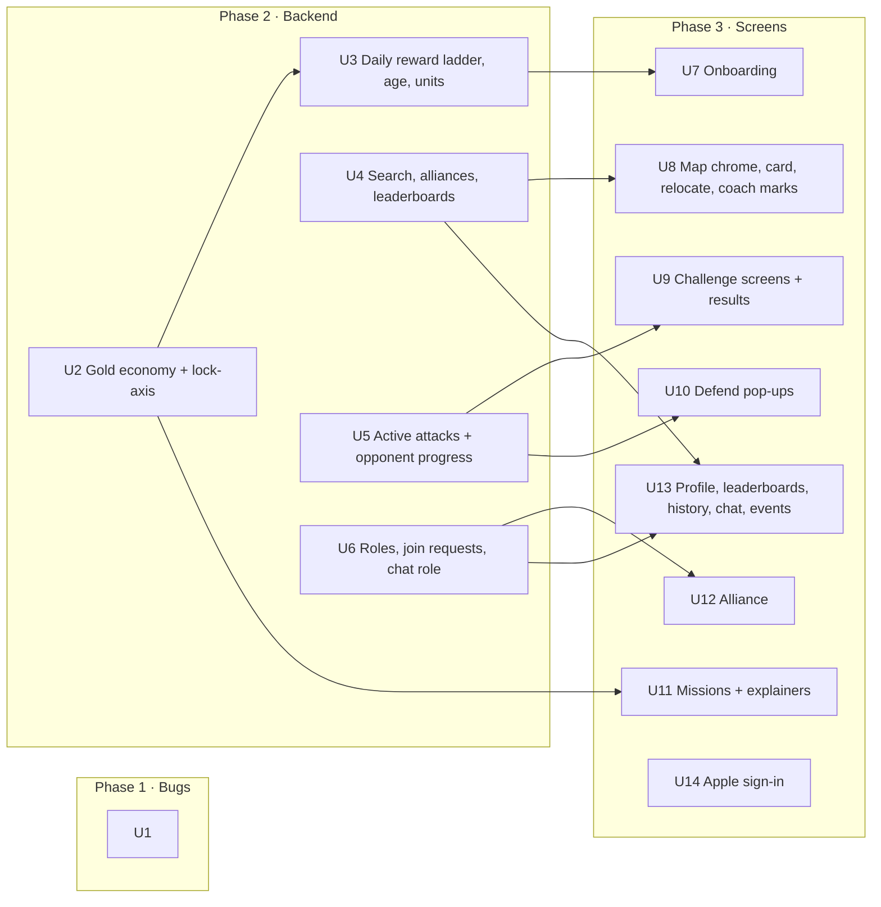

# feat: Updated UX prototype parity (app + backend)

**Target repos:** `dominia` (this repo) and `dominia-backend` (sibling directory). Backend paths are prefixed `backend:`.

## Summary

Bring Figma mode to match every frame on the Updated UX prototype page (see origin). The work runs in three phases:
1. Fix the bugs found on device.
2. Build the backend the screens depend on: the four unbuilt backend units of the 2026-11-15 parity plan, plus the new needs on this page.
3. Reshape the app screens area by area.

Every change targets Figma mode. Legacy mode is untouched.

---

## Problem Frame

The prototype page adds screens, states and copy beyond the Final page that the app was built from. Research found that the parity plan's backend units were never implemented. Of its backend units, `backend:feat/figma-final-parity` only has U2, the flag reader. The app already calls several of those routes, and each call fails:

| Route the app calls | Feature that fails |
|---|---|
| `/me/active-attacks` | defend pop-ups |
| `/me/daily-reward` | daily reward |
| `/me/challenges/lock-axis` | mission lock |
| `/territories/search` | territory search |
| Distance and `self` leaderboard fields | Distance board, pinned own position |

Screens built against them stay broken until the backend exists.

---

## Requirements

All requirement IDs refer to the origin doc.

| ID | Area |
|---|---|
| R-A1–A5 | Bugs |
| R-B1–B9 | Onboarding |
| R-C1–C11 | Map, coach marks, challenges |
| R-D1–D6 | Defend and missions |
| R-E1–E7 | Alliance |
| R-F1–F6 | Profile, leaderboards, history, chat, events |
| R-G1–G7 | Backend |

Success criteria are carried from the origin:
- Every frame has a matching screen or state in the `figma-preview` build.
- None of the R-A bugs reproduce.
- New pure logic and backend services have tests.

---

## Key Technical Decisions

- **Backend before screens.** Screens that read new data ship after the route exists. This avoids a second round of "route not found" failures in production.
- **Pure view-models in `lib/`.** New logic lives in pure CommonJS modules tested under `lib/__tests__` (plain node jest), following `lib/territoryCard.js` and `lib/defendPopup.js`. This covers countdowns, reward ladders, history grouping, role mapping, result stats and relocate lists. Screens stay thin.
- **Figma copy goes in `locales/en.json` and `locales/ru.json`.** Existing keys are updated in place where legacy mode never shows them. New keys are added where legacy still uses the old ones.
- **Roles map as follows** (resolves the origin's open question):
  - FOUNDER → Captain
  - MARSHAL → Commander
  - OFFICER → Lieutenant
  - MEMBER → Troop

  Only the displayed label changes. Stored values and permissions keep their meaning, so no backfill is needed.
- **Join type is a column on alliances**, `open` or `invite_only`, defaulting to `open` so existing alliances behave as today. Pending requests get their own table and are accepted or declined by Captain or Commander.
- **Opponent progress comes from the contest row.** The contest row already holds both walkers' metres, so the contest status response adds `opponent_pct`. The bars render only when the field is present (resolves the origin's open question).
- **Connection lost uses NetInfo inside the challenge screen.** It only shows a banner. Sampling and syncing are unchanged, and samples already queue offline.
- **Coach marks reuse the one-shot walkthrough flags** (`lib/walkthroughFlags`). Three new keys fire after the tutorial cards, before the first-claim flight.
- **Relocate is client-only.** It lists the player's own territories (from `/me` territories) and flies the camera to one with the existing `centredFlightCamera`.
- **The daily reward ladder lives in the economy config**: `daily_reward_ladder: [60,70,80,90,100,120,200]`, with a flat amount as the fallback. The server picks the amount by `daily_reward_day`, and the app draws the strip from the same config.
- **Apple sign-in uses Clerk `oauth_apple`** through the existing `useSSO`. The button shows only when `EXPO_PUBLIC_APPLE_SIGNIN=1`, so it stays hidden until the owner configures Apple in Clerk.
- **Names ban symbols for new names only.** The client check and the backend's username validation accept letters and digits only. Existing names are never re-validated.

---

## High-Level Technical Design

Phase 3 units touch separate screens. Their only shared files are the two locale files and the theme, so they can run in parallel worktrees with locale merges resolved key by key.

---

## Implementation Units

### Phase 1 · Bugs

### U1. On-device bugs

- **Goal:** Fix the bugs that are visible today.
- **Requirements:** R-A1, R-A2, R-A3.
  - R-A4 lands in U9 and R-A5 in U4 and U13.
- **Dependencies:** none
- **Files:**
  - `locales/en.json`, `locales/ru.json` (map colour tip)
  - `lib/territoryCard.js`, `components/TerritoryCard.js`, `lib/__tests__/territoryCard.test.js`
  - `lib/usernameRules.js` (new), `screens/UsernameScreen.js`, `lib/__tests__/usernameRules.test.js` (new)
- **Approach:**
  - **Colour tip:** fix it to read green for yours, blue for alliance and red for enemy.
  - **Card price:** the card model takes a `free` flag. MapScreen passes it with `firstClaim`, and the CTA then drops the Gold price.
  - **Name rules:** a new pure module returns `ok`, `tooShort`, `tooLong` or `symbol` from the name text alone, which drives a live error and a red border. NEXT stays disabled for invalid names, but the error now shows without pressing it.
- **Test scenarios:**
  - The card model with `free: true` has no price on its CTA.
  - The card model with `free: false` keeps the tier price.
  - Name rules:
    - `"nick_1"` returns `symbol`.
    - `"nick.r"` returns `symbol`.
    - `"Nick1"` returns `ok`.
    - `"ab"` returns `tooShort`.
    - A 21-character name returns `tooLong`.
    - An empty name returns `tooShort` but shows no error until the field is touched.
  - The locale test asserts that the colour tip mentions green before red.
- **Verification:** On the emulator, the colour tip and the free card show correctly, and typing "a.b" shows the symbol error.

### Phase 2 · Backend (`dominia-backend`)

### U2. Gold economy and mission lock

- **Goal:** The backend prices and rewards in Gold when `multi_resource_economy` is off, and supports `POST /me/challenges/lock-axis`.
- **Requirements:** R-D5 (lock); prerequisite for the result-screen rewards (R-C11) and the defend fee (R-D1).
- **Dependencies:** none
- **Files:** as listed in parity plan U5:
  - `backend:src/modules/territory/contest.costs.ts`, `contest.service.ts`, `contest-defend.service.ts`, `contest-defend-preview.service.ts`, `contest-walk.queries.ts`
  - `backend:src/modules/me/challenge.formulas.ts`, `challenge-complete.service.ts`, `challenges-today.routes.ts`
  - `backend:src/modules/me/lock-axis.routes.ts` (new)
  - matching `*.test.ts` files
- **Approach:** follow parity plan U5 verbatim (see `docs/plans/2026-11-15-001-feat-figma-final-parity-plan.md`, U5). The cost and reward tables come from `getEconomyConfig()`.
- **Patterns to follow:** gold deduction and refund in `backend:src/modules/territory/claim-start.service.ts`.
- **Test scenarios:**
  - Contest start with the flag off deducts the tier's Gold.
  - With insufficient Gold it rejects with the `InsufficientGoldError` shape.
  - Defend with the flag off charges 10 Gold.
  - Mission completion awards 10, 20 or 40 Gold and no Iron.
  - The first `lock-axis` call locks.
  - A second `lock-axis` call rejects.
  - A lock after completing a mission on the other axis rejects.
  - With the flag on, existing tests pass unchanged.
- **Verification:** The backend test suite passes in both flag states.

### U3. Daily reward ladder, age and units

- **Goal:** Ship `GET /me/daily-reward`, `POST /me/daily-reward/claim`, and `PATCH /me` for `age_band` and `units`, with the 7-day ladder.
- **Requirements:** R-B6, R-G5
- **Dependencies:** U2 (economy config shape)
- **Files:**
  - parity plan U6 files
  - `backend:src/shared/flags.ts` (`daily_reward_ladder` default)
- **Approach:**
  - Follow parity plan U6.
  - The claim amount is `ladder[day-1]`, falling back to the flat `daily_reward_gold` when the ladder is missing.
  - Day 8, or any missed day, resets to 1.
  - `GET` also returns `ladder` so the app can draw the strip.
- **Test scenarios:**
  - All of the parity plan U6 scenarios.
  - Consecutive claims on days 1–7 return the ladder amounts.
  - The day after day 7 returns day 1 with 60.
  - A missing ladder in the config uses the flat amount.
- **Verification:** The migration applies and rolls back, and the tests pass.

### U4. Search, alliance data, leaderboards

- **Goal:**
  - Territory and alliance search.
  - Alliance description and rules.
  - Territories held per member.
  - A Distance board and `self` on every board.
- **Requirements:** R-A5, R-C4, R-E2, R-E3, R-F3, R-G1
- **Dependencies:** none
- **Files:** parity plan U7 files
- **Approach:**
  - Follow parity plan U7.
  - Search results add `owner_scope` (`own`, `alliance`, `enemy` or `unclaimed`) and `distance_m` from the caller's home pin, which the C3 rows need.
  - The leaderboard service accepts `distance`.
  - It returns `self` as `{rank, value}`, or null when the caller has no value on that board.
- **Test scenarios:**
  - All of the parity plan U7 scenarios.
  - A search result for an ally's territory carries `owner_scope: "alliance"`.
  - `distance_m` is null when the caller has no home pin.
  - `GET /leaderboards/distance/players` returns 200.
- **Verification:** The new routes are registered, the app's Distance tab loads, and the pinned row shows.

### U5. Active attacks and opponent progress

- **Goal:**
  - Ship `GET /me/active-attacks`.
  - Expose the opponent's progress on live contests.
  - Report "an ally is defending your territory".
- **Requirements:** R-C8, R-D1, R-D3, R-D4, R-G2, R-G6
- **Dependencies:** none
- **Files:**
  - parity plan U8 files
  - `backend:src/modules/territory/contest-walk.routes.ts` and its queries (status response)
  - matching tests
- **Approach:**
  - Follow parity plan U8.
  - Each entry adds `window_ends_at`, used for the TIME TO RESPOND countdown.
  - When the caller owns the territory and an ally accepted, the entry carries `scope: "own"` and `defended_by`; the app shows the D8 pop-up for this.
  - The contest walk status adds `opponent_pct`, taken from the other side's walked metres over the required distance.
- **Test scenarios:**
  - All of the parity plan U8 scenarios.
  - `window_ends_at` equals the contest start plus the defend window.
  - The owner whose ally is defending gets `defended_by`.
  - `opponent_pct` is 0 before the defender starts.
  - `opponent_pct` is capped at 100.
- **Verification:** On the emulator, a seeded contest shows the pop-up.

### U6. Alliance roles, join requests, chat role

- **Goal:**
  - Alliances have an Open or Invite only join type.
  - Players can request to join, and leaders approve or decline.
  - Responses carry the display role.
  - Chat messages carry the sender's role.
- **Requirements:** R-E3, R-E5, R-F5, R-G3, R-G4
- **Dependencies:** none
- **Files:**
  - `backend:prisma/migrations-manual/20261127-alliance-join-type/up.sql`, `down.sql`
  - `backend:prisma/schema.prisma`
  - `backend:src/modules/alliance/join.service.ts`, `join.routes.ts`
  - `backend:src/modules/alliance/join-request.routes.ts`, `join-request.service.ts`, `join-request.service.test.ts` (new)
  - `backend:src/modules/alliance/get.routes.ts`, `alliance.queries.ts`
  - `backend:src/modules/chat/chat.queries.ts`, `chat.service.ts`
  - matching tests
- **Approach:**
  - Add `alliances.join_type` (default `open`) and an `alliance_join_requests` table: id, alliance, player, created, status, with one pending request per player.
  - `POST /alliances/:id/join`:
    - Open alliances join immediately, as today.
    - Invite-only alliances create a request and return `{status: "requested"}`.
  - `GET /alliances/:id/requests` lists pending requests for Captain or Commander.
  - `POST /alliances/:id/requests/:rid/accept|decline` resolves one. Accepting reuses the join path, including the capacity check.
  - Member and chat payloads add `role`; the app maps it to a display label.
- **Test scenarios:**
  - Joining an Open alliance joins immediately.
  - Joining an Invite only alliance creates a pending request and does not join.
  - A duplicate request returns the existing one.
  - A Troop accepting a request is refused (403).
  - A Captain accepting adds the member and resolves the request.
  - Accepting into a full alliance rejects with the capacity error.
  - Chat messages include the sender's role.
  - A sender with no alliance has a null role.
- **Verification:** The migration applies and rolls back, and the tests pass.

### Phase 3 · Screens (`dominia`)

### U7. Onboarding

- **Goal:** Make the frames from Splash through Tutorial 5 (A1–A13), plus the two name edge cases (A4b, A4c), match Figma.
- **Requirements:** R-B1–R-B9
- **Dependencies:** U1 (name rules), U3 (ladder)
- **Files:**
  - Screens and components:
    - `screens/SplashScreen.js`, `screens/LandingScreen.js`, `screens/SignInScreen.js` (Figma branch), `screens/UsernameScreen.js`, `screens/AgeScreen.js`
    - `screens/DailyRewardScreen.js`, `screens/CityIntroScreen.js`, `screens/FigmaOnboardingScreen.js`
    - `components/WelcomeOverlay.js`, `components/TutorialCards.js`
  - Logic and tests:
    - `lib/onboardingFlow.js` (age range, back steps, last-card actions), `lib/dailyReward.js` (new: ladder view-model)
    - `lib/__tests__/onboardingFlow.test.js`, `lib/__tests__/dailyReward.test.js` (new)
  - `locales/*.json`
- **Approach:**
  - **Copy:** taken verbatim from the onboarding audit (see origin).
  - **Age:** the range becomes 1–100 with a default of 24. The under-13 block and band derivation are unchanged.
  - **Back steps:** age gets a back step to the name screen. The last tutorial card shows BACK and START PLAYING.
  - **Landing:** a static map backdrop, rendered as a non-interactive Mapbox view with scrims, reusing `ChallengeMap` styling.
  - **Daily reward:** the strip comes from the `GET /me/daily-reward` ladder, falling back to the config ladder.
- **Test scenarios:**
  - Age values 1 and 100 clamp correctly.
  - The default age is 24.
  - An age of 12 routes to the blocked step.
  - `BACK` from age goes to the username step.
  - `BACK` from tutorial card 5 goes to card 4.
  - START PLAYING finishes the tutorial.
  - Ladder view-model:
    - Day 3 marks D3 as today and D1–D2 as collected.
    - Day 7 marks D7 as today.
    - A missing ladder falls back to a flat amount.
- **Verification:** On the emulator, a fresh sign-up goes through every A frame and matches Figma.

### U8. Map chrome, territory card, relocate, coach marks

- **Goal:** Make the map home, key, search and territory card frames (C1–C5), the Relocate sheet (C9, C10) and the three coach marks (B1–B3) match Figma.
- **Requirements:** R-C1–R-C6
- **Dependencies:** U4 (search fields)
- **Files:**
  - Components:
    - `components/MapSideRail.js`, `components/MapTopBar.js`, `components/TerritorySearch.js`, `components/TerritoryCard.js`
    - `components/RelocateSheet.js` (new), `components/CoachMark.js` (new)
  - `screens/MapScreen.js`
  - Logic: `lib/territoryCard.js`, `lib/relocate.js` (new), `lib/coachMarks.js` (new)
  - Tests: `lib/__tests__/territoryCard.test.js`, `lib/__tests__/relocate.test.js` (new), `lib/__tests__/coachMarks.test.js` (new)
  - `locales/*.json`
- **Approach:**
  - **Side rail:** five square tiles with gaps. The key tile has a lime border while the key is open.
  - **Card model:** gains `tags`, `metaLine` (`"1,094 M · 30 MIN LIMIT"`), an `explainer`, a `heldFor` line and a `viewAlliance` action.
  - **Relocate list:** sorted by distance, with name, "HELD N DAYS · X KM AWAY" and GO.
  - **Coach marks:** a one-shot state machine: side panel → tap a territory → card. It fires once after the tutorial, and any step can be skipped.
- **Test scenarios:**
  - Card model:
    - Enemy territory has tags `[ENEMY, SOLO]`, an explainer, and the CTA "8 GOLD · CONTEST TERRITORY".
    - Alliance territory has `viewAlliance` and no CTA.
    - The meta line formats 1094 as "1,094 M".
  - Relocate:
    - Three territories are sorted by distance.
    - With no home pin, rows have no distance.
    - An empty list gives the empty state.
  - Coach marks:
    - `start → sidePanel`, `next → tapTerritory`, then `territorySelected → card`, then `done`.
    - Once done, it never starts again.
    - Skip from any step goes to done.
- **Verification:** On the emulator, the C and B frames match. Relocate flies to an owned territory.

### U9. Challenge screens and results

- **Goal:** Make the start walk, in-progress, cancel, cancelling, securing and result frames (B4–B9, C6–C8, D2–D5) match Figma, including the connection-lost banner.
- **Requirements:** R-A4, R-C7–R-C11, R-D2
- **Dependencies:** U5 (opponent progress)
- **Files:**
  - `screens/ActiveClaimScreen.js`
  - `components/ChallengeResultOverlay.js`, `components/CancelChallengeDialog.js` (new), `components/ConnectionBanner.js` (new)
  - `lib/challengeScreen.js`, `lib/challengeResult.js` (new)
  - Tests: `lib/__tests__/challengeScreen.test.js`, `lib/__tests__/challengeResult.test.js` (new)
  - `locales/*.json`
  - `package.json`, only if `@react-native-community/netinfo` is not already a dependency
- **Approach:**
  - **Header model:** returns the eyebrow, colour (lime for claim, red for attack, blue for defend), icon and cancel label per kind.
  - **Result model:** returns the moment word (TAKEN, HELD or LOST), its colour and the stats tiles. Stats are walked/time/reward for claims and wins, and you/opponent/Gold for losses.
  - **Cancel flow:** cancel opens a dialog. Confirming shows the "Cancelling…" state, then goes back.
  - **Securing:** becomes a full-screen state.
  - **Opponent bars:** render only when `opponent_pct` is present.
- **Test scenarios:**
  - Result model:
    - A won attack gives TAKEN in green with a reward tile of +tier Gold.
    - A failed attack (Case 8) gives LOST in red, with an opponent 100% tile and −Gold.
    - A defence held gives HELD.
    - A defence lost gives LOST.
    - The first free claim gives TAKEN with a reward of +0 shown as "FREE".
  - Header model:
    - An attack's eyebrow includes "DEFENDED BY {name}".
    - A defend's eyebrow includes "ATTACKED BY {name}".
  - Opponent bars are hidden when `opponent_pct` is undefined.
  - The connection banner state is visible only when offline and a challenge is active.
- **Verification:** On the emulator, start the first claim and see B4, B5, the cancel dialog and B7. Then complete a claim (demo walk bypass) and see securing and TAKEN.

### U10. Defend pop-ups

- **Goal:** Make the defend pop-up frames (D1, D6, D7, D8) match Figma.
- **Requirements:** R-D1, R-D3, R-D4
- **Dependencies:** U5
- **Files:**
  - `components/DefendPopup.js`, `lib/defendPopup.js`, `lib/__tests__/defendPopup.test.js`
  - `screens/MapScreen.js` (go straight to defending)
  - `locales/*.json`
- **Approach:**
  - **Model:** gains `countdown` (from `window_ends_at`), `secondaryLabel` (LET IT GO or NOT NOW), a `state: allyDefending` for D8 and a disabled DEFENCE IN PROGRESS button for D7.
  - **Defend action:** starts the defend directly, skipping DefenderAccept, in Figma mode only.
- **Test scenarios:**
  - Countdown at 292 seconds shows "04:52". Past the window it shows "—" and the CTA is disabled.
  - Solo owner: secondary is LET IT GO.
  - Ally: secondary is NOT NOW, and the title is ALLY UNDER ATTACK.
  - Owner with an ally defending gives `allyDefending` with "DEFENCE ENDS IN".
  - Already defended by another gives a disabled CTA labelled DEFENCE IN PROGRESS.
- **Verification:** The pop-ups render against a seeded contest.

### U11. Missions and explainers

- **Goal:** Make the mission frames (E1–E5) and the explainer button behaviour match Figma.
- **Requirements:** R-D5, R-D6
- **Dependencies:** U2 (lock-axis)
- **Files:**
  - `screens/MissionsScreen.js`, `components/WeeklyTaskCard.js`, `components/FeatureExplainer.js`
  - `lib/missions.js`, `lib/__tests__/missions.test.js`
  - `locales/*.json`
- **Approach:**
  - **Rows:** each row model adds formatted progress ("3,240 / 5,000"), an IN PROGRESS chip and a claimable flag that adds a lime border.
  - **Lock button:** labelled "LOCK MARCH FOR TODAY". It drops the native Alert because Figma has none.
  - **FeatureExplainer:**
    - The last page reads GOT IT.
    - It supports optional rows and a footer.
    - The counter reads "01 / 02" at the top right.
    - The primary button is blue.
- **Test scenarios:**
  - Progress 3240 of 5000 formats as "3,240 / 5,000", with the IN PROGRESS chip.
  - A completed but unclaimed row is claimable.
  - The rewards-ready label counts claimable rows ("2 REWARDS READY").
  - In the locked state, the toggle shows the lock and the banner text.
- **Verification:** On the emulator, E1–E5 match Figma.

### U12. Alliance

- **Goal:** Make the alliance frames (F1–F8) match Figma.
- **Requirements:** R-E1–R-E7
- **Dependencies:** U4, U6
- **Files:**
  - `screens/AllianceScreen.js`, `components/AllianceDetailSheet.js`, `screens/CreateAllianceScreen.js`
  - `lib/allianceRoles.js` (new), `lib/__tests__/allianceRoles.test.js` (new)
  - `locales/*.json`
- **Approach:**
  - **Display:** the role mapper converts stored roles to display labels.
  - **Detail:** a 2×2 grid with location, territories, type and members.
  - **Join button:** REQUEST TO JOIN or JOIN, depending on `join_type`.
  - **Requested state:** a "Request sent" state for invite-only alliances.
  - **Member view:** an OPEN CHAT button, a red outlined LEAVE ALLIANCE button, and a leave confirm modal.
  - **Create screen:** a "names are permanent" note and inline field errors.
- **Test scenarios:**
  - Role mapping:
    - FOUNDER gives Captain.
    - MARSHAL gives Commander.
    - OFFICER gives Lieutenant.
    - MEMBER gives Troop.
    - An unknown role gives Troop.
  - The join button label follows `join_type`.
  - Create validation:
    - An empty name returns the Figma "has to be entered" error.
    - A taken short name maps to the inline short-name error.
- **Verification:** On the emulator, F1–F8 match Figma.

### U13. Profile, leaderboards, history, chat, events

- **Goal:** Make the profile, leaderboard, history, chat and events frames (G1–G11) match Figma.
- **Requirements:** R-F1–R-F6, R-A5
- **Dependencies:** U4, U6
- **Files:**
  - Screens:
    - `screens/ProfileAccordionScreen.js`, `screens/EditProfileScreen.js`, `screens/LeaderboardsScreen.js`
    - `screens/ActivityLogScreen.js`, `screens/ChatScreen.js`, `screens/EventsScreen.js`
  - `components/ActivityLogEvent.js`
  - Logic and tests:
    - `lib/leaderboardView.js`, `lib/activityHistory.js` (new)
    - `lib/__tests__/leaderboardView.test.js`, `lib/__tests__/activityHistory.test.js` (new)
  - `locales/*.json`
- **Approach:**
  - **Leaderboards:** Territories and Distance become a tab, and `self` renders as the pinned row.
  - **History model:**
    - Groups entries into TODAY, YESTERDAY and dated groups.
    - Maps backend event types to the Final event labels.
    - Hides events the Figma doesn't list (streak, level and influence) in Figma mode.
  - **Chat:** the sender line shows "NAME · TAG ROLE" or SOLO PLAYER.
- **Test scenarios:**
  - History grouping:
    - An entry from today groups under TODAY.
    - An entry from yesterday groups under YESTERDAY.
    - An older entry groups under its formatted date.
  - Event label mapping:
    - `territory_claimed` gives EMPTY TERRITORY CLAIMED.
    - `contest_won` gives ENEMY TERRITORY CLAIMED.
    - `contest_expired` (as attacker) gives ENEMY TERRITORY CLAIM FAILED.
    - `defence_held` gives TERRITORY DEFENDED.
  - The leaderboard view builds a pinned row from `self`, and none when `self` is null.
  - The chat sender label is "RAVI · JIC TROOP" with a role, and "SOLO PLAYER" with no alliance.
- **Verification:** On the emulator, G1–G11 match Figma, and the Distance tab loads.

### U14. Apple sign-in

- **Goal:** A CONTINUE WITH APPLE button through Clerk.
- **Requirements:** R-B2, R-G7
- **Dependencies:** U7
- **Files:**
  - `screens/LandingScreen.js`
  - `lib/authProviders.js` (new), `lib/__tests__/authProviders.test.js` (new)
  - `app.json` (iOS `usesAppleSignIn`)
- **Approach:**
  - **Visibility:** a pure `enabledProviders(env, platform)` returns `apple` only when `EXPO_PUBLIC_APPLE_SIGNIN=1`.
  - **Sign-in:** the button calls `startSSOFlow({ strategy: 'oauth_apple' })` and shares the Google success path.
- **Test scenarios:**
  - The env var unset gives no `apple`.
  - The env var set to `1` gives `apple` first.
- **Verification:** The button is hidden by default. With the env var set and Clerk configured, it completes sign-in. The owner checks this.

---

## Scope Boundaries

- Not designed, so not built: the Activity screen, the Statistics button page and Research.
- Legacy mode is unchanged.
- Figma sample data is not copied.

### Deferred to Follow-Up Work

- **Database migrations:** they run against production only when the owner applies them.
- **Apple developer and Clerk setup:** the owner does these.
- The backend's own repo still needs a PR. The app PR stacks on #1.

---

## Risks & Dependencies

- **Backend deploy order:** screens read new fields defensively. Missing fields hide the new elements and never crash, so app builds can ship before the backend deploys.
- **`MapScreen.js` and `ActiveClaimScreen.js` are large and choreography-sensitive.** Changes stay behind `figmaChrome` and touch render branches, not timing.
- **Locale merge conflicts across parallel units:** each unit adds keys under its own namespace (`onboarding2.*`, `map2.*` and so on) only where legacy needs the old key.
- **Opponent progress accuracy depends on the walk sync cadence.** The bar may lag by one sync interval, which is acceptable.

---

## Sources & Research

- Origin: `docs/brainstorms/2026-11-27-updated-ux-prototype-parity-requirements.md`
- The four frame-by-frame audits, 2026-11-27. Their Figma screenshots are in the session scratchpad.
- Unbuilt backend units: `docs/plans/2026-11-15-001-feat-figma-final-parity-plan.md`, U5–U8.
- On-device run of the `figma-preview` build, 2026-11-27.
