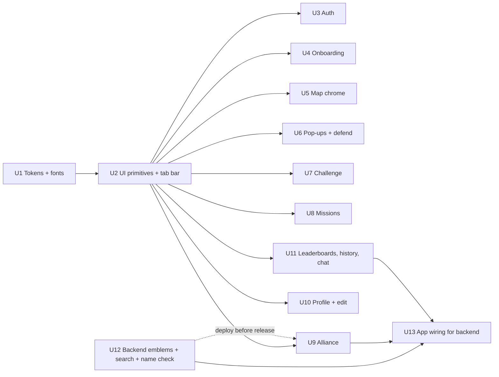

# feat: Dominia-Temp redesign

## Summary

Restyle the whole app to the Dominia-Temp Figma page and implement the screen-level UX it shows: auth, onboarding, map, challenge, missions, alliance, profile, leaderboards, history and chat. The work starts by changing shared tokens and fonts so every screen moves at once. It then adds a small set of slanted and cut-corner primitives and restyles each area against its board. A separate backend PR adds the alliance logo set, leaderboard search and a full-name-taken check.

---

## Problem Frame

The page replaces the current palette (warm white, electric blue, signal lime) and fonts (Sofia Sans Extra Condensed, Geist Mono, Instrument Sans) with:
- **Palette:** black backgrounds, blue `#0731D1`, white `#FDFDFD`, and lime `#84FF44` for links and accents.
- **Fonts:** a heavy slanted display face, IBM Plex Sans for body text, and IBM Plex Sans Condensed Bold Italic for buttons and links.
- **Controls:** parallelogram buttons, and inputs and cards with a clipped bottom-right corner.

Most screens already exist from the Updated UX work; this pass mostly restyles them and changes copy and layout. A few things are new: inline sign-in error states, an age slider, a 10-logo alliance picker, Solo/Alliance leaderboard tabs with search, and Global/Alliance chat tabs. Profile photo change/remove already exists in `screens/EditProfileScreen.js` and only needs restyling.

The app has no shared Button or TextInput. About 600 buttons are styled inline, and there are about 560 hardcoded font strings and 550 hex colours. A token-only change therefore cannot finish the job.

---

## Requirements

**Foundation**
- R1. The new palette and fonts apply app-wide, in both `legacy_tabs` modes (user decision, 2026-11-28).
- R2. Buttons, inputs, cards, tiles, tabs and the bottom tab bar use the slanted and cut-corner shapes from the page. This applies to every screen on the page; screens not on the page take tokens and fonts only (see Scope Boundaries).

**Auth (boards: Login flow, Sign up · Google, Sign up · Email, Sign in failures, Forgot password)**
- R3. The splash shows the radar mark, DOMINIA. wordmark, "WALK. CLAIM. CONQUER. DEFEND." and "Finding your ground…".
- R4. Sign-up chooser: CONTINUE WITH GOOGLE (outlined), OR, CONTINUE WITH EMAIL (blue), the terms line, and "Already playing? SIGN IN »".
- R5. Email sign-up (EMAIL ADDRESS, PASSWORD with "8+ characters", SIGN UP »).
- R6. Sign-in: FORGOT PASSWORD?, SIGN IN », OR, CONTINUE WITH GOOGLE, and "Don't have an account? SIGN UP »".
- R7. A wrong password shows "Incorrect password. Try again." on the password field, with a red field.
- R8. An unknown email shows "No account found with this email." on the email field.
- R9. Reset password, step 1 "LOCKED OUT?": email, then SEND RESET LINK », then BACK TO SIGN IN.
- R10. Reset password, step 2 "GET BACK IN": verification code with RESEND CODE, new password, CREATE NEW PASSWORD », and an error state for a wrong code.

**Onboarding (boards: Core loop explanation, rewards and territories, how it works)**
- R11. FTUE welcome: "WELCOME, <NAME> · FTUE 1 OF 4", "WALK IT TO OWN IT.", the city body copy, LET'S GO », SKIP, and progress dashes.
- R12. CHOOSE YOUR NAME uses the "Commander name" placeholder. The name-taken and symbol errors appear inline with a red field.
- R13. SELECT YOUR AGE: a slider from 1 to 100 (ticks at 25 / 50 / 75), a SELECTED AGE box, and NEXT » disabled until an age is chosen. The under-13 block stays.
- R14. DAILY REWARDS shows the gold-biscuit art, "Day N: amount" and TAP TO COLLECT.
- R15. "<CITY> MAP" intro with a map preview, the city pin label and NEXT ».
- R16. "WELCOME TO DOMINIA" (tap to continue), then the core-loop cards: What are territories?, How to start?, Claiming territory, Attack or defend, End goal. Each card has SKIP / NEXT ».

**Map (boards: Main screen, Main screen explanation, cases 1–8, Territory pop-up states)**
- R17. Header: an initials tile, a Gold pill, a level pill (⚡ is the player's level, user decision), and the search field "Search places, runners, alliances". The placeholder is copy only; search stays territory-only (runner and alliance results are deferred).
- R18. The side rail is five slanted square tiles: colouring/key, locate, leaderboard, log, chat.
- R19. The key reads Your / Alliance / Enemy Territory. Territories render green, blue and red, with a flag mark.
- R20. Coach marks: side panel, tap a territory, territory pop-up.
- R21. Territory pop-up states. Each shows an eyebrow, the name, DISTANCE / TIME LIMIT, and a CTA:
  - unclaimed: "10 gold | START CLAIMING »"
  - claimed: "CLAIMED!" with OK
  - enemy: "<OWNER> TERRITORY" or "ENEMY TERRITORY!" with "8 gold | CONTEST TERRITORY »" or ATTACK »
  - alliance: "ALLIANCE TERRITORY - TAG" with OK
- R22. Defend pop-ups for a solo player and an alliance member: "UNDER ATTACK BY <NAME>", the body copy, and DEFEND TERRITORY ».

**Challenge (boards: Challenge flow, cases 1–8)**
- R23. Ready screen: "WALK 5M TO CLAIM IT.", a big seconds-to-start countdown on a tile, "10 Gold is used once you start", START WALK » and NOT YET.
- R24. In progress: a CLAIMING / ATTACKING / DEFENDING eyebrow, the name, IN PROGRESS, a perimeter-fill percentage, the instruction line, TIME LEFT, STEPS WALKED, a recenter tile, and CANCEL CLAIM / ATTACK / DEFEND.
- R25. Cancel opens a bottom confirm: "Are you sure that you want to cancel the claim?" with CONTINUE CHALLENGE and CANCEL CLAIM. It then shows "Cancelling the Claim…" or "Securing the Claim…".
- R26. Results: VICTORY in green or DEFEAT in red, with the territory art and the owner line. This supersedes TAKEN / HELD / LOST, because Figma is the source of truth.

**Sections**
- R27. Missions:
  - "YOUR MISSIONS" with an info icon and the refresh line.
  - MARCH / RANGE tabs with the description, EASY / MEDIUM / HARD rows with progress bars and gold rewards, and a LOCK → CLAIM button.
  - ALLIANCE MISSIONS card, or the no-alliance line.
  - The MISSIONS TYPE explainer.
- R28. Alliance:
  - ALLIANCE list with search, rows showing the emblem, name-TAG, territories and members, and the "Create your own Alliance / CREATE" footer.
  - Detail modal with JOIN.
  - Member view with ALLIANCE MISSIONS / MESSAGES / MEMBERS and LEAVE.
  - Explainers.
- R29. Create alliance:
  - Full name (3–24) and short name (3 letters).
  - A 10-logo picker and Rules.
  - Inline errors for empty, full-name-taken and short-name-taken.
- R30. Profile accordion: Your Territories, Activity, Resource Balance, App Settings, Statistics. Edit profile: MY DETAILS, CHANGE PHOTO / REMOVE PHOTO, NAME.
- R31. Leaderboards:
  - SOLO / ALLIANCE tabs, a Territories / Distance dropdown and Search.
  - A top-3 podium and ranked rows with "Nth Place".
  - A pinned YOUR POSITION row.
- R32. History: day-stamped rows with a typed icon (claimed / failed / defended, in green or red).
- R33. Chat: GLOBAL / ALLIANCE tabs, sender role, a lime-tinted @mention row, and the message field with a send tile. GLOBAL shows a coming-soon empty state (user decision).

**Backend (dominia-backend, user decision: include)**
- R34. Alliance emblems accept the 10 Figma logos; existing values stay valid. Territory alliance leaderboard rows include `emblem`.
- R35. Leaderboards accept a name search.
- R36. Founding an alliance whose full name is taken returns a distinct error. A short-name race returns 409, not 500.

---

## Scope Boundaries

- Google's account chooser and consent sheets (boards 03 and 04 of the Google flow) are OS or Google UI. They are not built.
- The map keeps the real Mapbox basemap. The drawn grid on the boards is illustration, not a style to recreate.
- Sample data on the boards (Moksh, Cubbon Park, Bengaluru, 1,240) is not copied.
- Legacy-only layouts, and screens not on the page (for example `WelcomeScreen`, `SessionMismatchScreen`, `AllianceJoinedScreen`, `DefenderAcceptScreen`, `ProfileScreen`, `WalletScreen`, `PublicProfileScreen`), keep their structure and rectangular controls; they only take on the new tokens and fonts.

### Deferred to Follow-Up Work
- **Runner and alliance results in map search:** the placeholder promises them, but search stays territory-only.
- **Moving legacy and off-page screens onto the shape primitives:** a later sweep.
- **Global chat channel:** a Discord API or a backend `global` room type. The tab ships with an empty state.
- **"Statistics" accordion content:** not designed. It keeps today's content.
- **Asset boards** (Gold biscuits, Runner gold bag, Octagonal gold coins): only the biscuit art is used now, on the daily reward and the mission rows. The rest wait for their screens.

---

## Context & Research

### Relevant Code and Patterns
- **Tokens:** `lib/theme.js`, imported by about 60 files.
- **Font loading:** `App.js` (`useFonts`).
- **Tab bar:** `App.js` `makeTabOptions` / `TabNavigator`.
- **Mode switch:** `lib/navLayout.js`.
- **Per-area screens:** `screens/SplashScreen.js`, `LandingScreen.js`, `SignInScreen.js` (sign-in, sign-up and code verify), `ForgotPasswordScreen.js` (already two steps: email, then code + new password).
- **Onboarding:** `components/OnboardingTutorialLifecycle.js`, `WelcomeOverlay.js`, `TutorialCards.js`, and `screens/FigmaOnboardingScreen.js` (Age → DailyReward → CityIntro), plus `UsernameScreen.js`.
- **Map:** `screens/MapScreen.js`.
  - Inline key around lines 3447–3480.
  - Layer styles around lines 2370–2890.
  - The `territories-emblems` SymbolLayer already exists.
  - Chrome: `components/MapTopBar.js`, `MapSideRail.js`, `CoachMark.js`, `TerritoryCard.js` + `lib/territoryCard.js`, `DefendPopup.js` + `lib/defendPopup.js`.
- **Challenge:** `screens/ActiveClaimScreen.js`, with `components/ChallengeMap.js`, `CancelChallengeDialog.js`, `ChallengeStatusScreen.js`, `ChallengeResultOverlay.js`, and copy in `lib/challengeScreen.js` and `lib/challengeResult.js`.
- **Sections:**
  - Missions: `screens/MissionsScreen.js` + `components/WeeklyTaskCard.js`.
  - Alliance: `screens/AllianceScreen.js` (`FigmaBrowse`, `MemberContent`), `components/AllianceDetailSheet.js`, `screens/CreateAllianceScreen.js`, `lib/allianceEmblems.js` (7 emblems).
  - Profile: `screens/ProfileAccordionScreen.js` + `components/Accordion.js`, `screens/EditProfileScreen.js`.
  - Leaderboards, history, chat: `screens/LeaderboardsScreen.js`, `screens/ActivityLogScreen.js`, `screens/ChatScreen.js`.
- **Tests:** pure-logic jest suites live in `lib/__tests__/`. Colour pins are in `territoryCard.test.js` and `homeBases.test.js`. Copy pins are in `challengeScreen`, `challengeResult`, `defendPopup`, `leaderboardView`, `missions`, `territoryCard`, `allianceRoles` and `chatSender`.
- **Backend** (`dominia-backend`):
  - `src/modules/leaderboard/*` (`GET /leaderboards/:board/:subject`, already returns `self`; no search; territory alliance rows lack `emblem`).
  - `src/modules/alliance/alliance.formulas.ts` `ALLIANCE_EMBLEMS` (7), and `found.routes.ts` / `found.service.ts` (only `short_name_taken`; a short-name race returns 500).
  - The `alliances_emblem_check` DB constraint.
  - `PATCH /me` already accepts `avatar_url`.
  - `players.level` is already returned by `/me`.

### Institutional Learnings
- Figma is the source of truth. App-only features stay behind Remote Config flags and are not deleted (memory: figma-source-of-truth).
- Clerk's `getToken` is not referentially stable. Use the ref-backed wrapper in any new focus loaders (fixed this branch in `ProfileAccordionScreen`, `AllianceScreen`).
- Manual backend migrations must be applied in Supabase before the backend deploys. This Mac has no Docker, so DB-backed backend tests cannot run locally (memory: backend-deploy-and-testing).

### Tokens read from Figma code (node 43:327)
- **Display:** Archivo Black, skewed -14°, 40px, letter-spacing 0.8.
- **Labels:** IBM Plex Sans Bold, 11px, tracking 1.54–3.3, white at 62% opacity.
- **Body:** IBM Plex Sans Medium. **Buttons and links:** IBM Plex Sans Condensed Bold Italic, 14–19px.
- **Colours:**
  - white `#FDFDFD`
  - muted `rgba(253,253,253,0.62)`
  - placeholder `rgba(253,253,253,0.3)`
  - blue `#0731D1`
  - lime `#84FF44`
  - card border `#2A2A2A`
- **Sizes:** inputs are 54pt tall and buttons 56pt.

---

## Key Technical Decisions

- **Token-first reskin, then per-screen work.** Retune `lib/theme.js` values while keeping the token *names*, and remap hardcoded font and colour literals with a one-time scripted pass. This moves about 60 files at once, and the per-screen units then handle only shape, layout and copy. The alternative, rewriting each screen by hand, would leave drift everywhere the units don't touch.
- **Fonts:**
  - Display uses `Archivo_900Black_Italic`, which is already installed (`@expo-google-fonts/archivo`), instead of Archivo Black plus a -14° skew. A true italic avoids the clipping and hit-area problems of `transform: skewX` on Text.
  - Add `@expo-google-fonts/ibm-plex-sans` and `@expo-google-fonts/ibm-plex-sans-condensed`.
  - Map the old roles onto the new families:
    - display → Archivo Black Italic
    - mono labels → Plex Sans Bold
    - mono data → Plex Sans SemiBold
    - body → Plex Sans Medium
    - a new `action` role → Plex Sans Condensed Bold Italic
  - Drop Sofia, Geist and Instrument from `useFonts` only after no references remain.
- **Palette semantics stay; values change.** `action` becomes `#0731D1` and `lime` becomes `#84FF44` (links and accents). Backgrounds become black. The territory triad keeps its meaning (green = yours, blue = alliance, red = enemy). Its hexes are read from the pop-up and case boards at the start of U1, before any remap runs.
- **Ownership is data, not colour.** Today `lib/territoryCard.js` and `MapScreen.js` infer ownership by comparing fill hexes. U1 adds an explicit `ownership` property (`yours`, `alliance`, `enemy`, `unclaimed`) where MapScreen builds features. Classification reads that property, and colour is derived from it, so later palette tuning can't misclassify territory.
- **`#3155FF` is never remapped automatically.** It means both "action" and "alliance" today, in about 46 places across about 18 files. Every occurrence, along with local constants such as `ALLIANCE`, `ALLIANCE_GREEN` and `CLAIM_BUTTON`, is classified by hand as `colors.action` or `colors.alliance`. The script handles only unambiguous literals.
- **Shapes come from a few primitives in `components/ui/`:** slanted button (filled, outlined, ghost), cut-corner field, cut-corner card/row, slanted tile/chip, slanted tab pair, and screen title with eyebrow. Shapes are drawn with `react-native-svg` polygons sized by `onLayout`, so borders and fills stay crisp and hit areas stay rectangular.
- **Result words follow the new board:** VICTORY and DEFEAT replace TAKEN / HELD / LOST, because the page explicitly shows them.
- **Sign-in errors map Clerk error codes**, not message strings, through a pure helper:
  - `form_password_incorrect` → the password field.
  - `form_identifier_not_found` → the email field.
  - `form_code_incorrect` / `verification_failed` → the code field.
  - Anything else → a generic error.
- **Profile photo uses Clerk** (`user.setProfileImage`), then `PATCH /me { avatar_url }`. This is what the `avatar_url` column was designed for; no storage backend is needed.
- **Alliance logos are new emblem ids.** Add 10 ids for the Figma logos to the existing enum and keep the 7 old ids valid, so existing alliances still render. The picker shows only the 10 new logos. Because the backend rejects unknown emblem ids on create, the app build containing the picker must not reach players until U12 is deployed and its migration applied.
- **Leaderboard search keeps global rank.** The server filters the fully ranked list after ranks are assigned and before the 100-row cut, so a search shows each match's true "Nth Place". The app always applies the same name filter to the rows it receives, which is a no-op on a filtered response and correct on an old backend.
- **Primitives own accessibility and busy state.** Every primitive sets a role, a label and state (disabled, selected, busy), and keeps a 44pt minimum hit area. Control heights are minimums, so the shape grows with content at large text sizes. `SlantButton` has a `loading` prop that blocks presses.

---

## Open Questions

### Resolved During Planning
- Scope of the look: whole app (user).
- The ⚡ pill: the player's level from `/me` (user).
- Global chat: tab UI plus an empty state; backend deferred (user).
- Backend work: included as a separate dominia-backend PR (user).

### Deferred to Implementation
- Exact hex values for card surface and border gradients: read them with `get_design_context` per screen.
- Flag vs emblem on the map symbol layer: one icon per feature. Use the flag for solo-owned territory and keep the alliance emblem for alliance territory, unless on-device review shows the boards' all-flag look is clearer.
- Clerk enumeration protection may hide `form_identifier_not_found`. If so, R8 falls back to the generic error, and this is noted for the owner.
- The SVG glyphs for the 10 logos: export them from the create-alliance board's logo nodes.
- Whether the Mapbox night preset needs extra tinting to read as near-black: tune on device.
- Which Clerk error codes this Clerk version actually returns for an unknown email and a wrong password: confirm on a dev build and adjust the mapping table.

---

## High-Level Technical Design

The units run in five phases. The foundation units come first, and the backend PR runs alongside the app work.

---

## Implementation Units

### Phase A: Foundation

### U1. Tokens, fonts and literal remap

**Goal:** the whole app takes on the new palette and fonts with no layout change.

**Requirements:** R1

**Dependencies:** none

**Files:**
- Modify: `lib/theme.js`, `App.js` (useFonts), `package.json`, `lib/territoryCard.js`
- Modify: every screen or component holding hardcoded `SofiaSansExtraCondensed_*`, `GeistMono_*`, `InstrumentSans_*` names or old hex values. The heaviest are `screens/MapScreen.js`, `AllianceScreen.js`, `ProfileScreen.js`, `ActiveClaimScreen.js`, `ChatScreen.js`, `LeaderboardsScreen.js` and `lib/medalBadges.js`.
- The codemod runs from the scratchpad and is not committed; its old→new mapping table goes in the PR description.
- Test: `lib/__tests__/theme.test.js` (new); update `lib/__tests__/territoryCard.test.js` and `lib/__tests__/homeBases.test.js`

**Approach:**
- Rewrite the token values while keeping their names.
- Add an `action` font role and a `surfaceLine` border token.
- The codemod maps each old font name to its new role font, and each old palette hex to its new token value. Files that already import the theme get `colors.*` / `fonts.*` references; the rest get the literal.
- Read the territory triad hexes from the boards first, then run the remap.
- List every `#3155FF` / `#2443D6` occurrence and classify it by hand as action or alliance; the script skips them.
- Add the `ownership` property where MapScreen builds territory features, and switch `lib/territoryCard.js` to classify from it.

**Patterns to follow:** the existing `colors` / `fonts` token names in `lib/theme.js`.

**Test scenarios:**
- Every value in `fonts` appears as a key inside App.js's `useFonts({...})` call. The test reads App.js from disk, because jest runs in node and can't import the font packages.
- No file under `screens/` or `components/` contains `SofiaSansExtraCondensed_`, `GeistMono_` or `InstrumentSans_`. A grep-style jest test reads the files from disk.
- `lib/territoryCard` classifies from `ownership`: yours, alliance, enemy and unclaimed each give their own state, and changing the colour tokens doesn't change the result.
- A feature with no `ownership` property falls back to the old colour comparison, so cached data still works.
- The colour pins in `homeBases.test.js` follow the new self token.

**Verification:** the app boots on the emulator with the new fonts everywhere and no missing-font warnings, and the full jest suite passes.

### U2. UI primitives and tab bar

**Goal:** reusable slanted and cut-corner controls, plus the restyled bottom tab bar.

**Requirements:** R2

**Dependencies:** U1

**Files:**
- Create: `components/ui/SlantButton.js`, `components/ui/CutField.js`, `components/ui/CutCard.js`, `components/ui/SlantTile.js`, `components/ui/SlantTabs.js`, `components/ui/ScreenTitle.js`, `components/ui/LinkText.js`, `components/ui/index.js`
- Create: `lib/slantGeometry.js` (pure polygon maths)
- Modify: `App.js` (`makeTabOptions`: the active tab gets a slanted blue tile behind the icon; labels in Plex Sans Bold caps)
- Test: `lib/__tests__/slantGeometry.test.js`

**Approach:**
- `SlantButton` has `variant` (primary, outline, ghost, disabled), optional leading content (cost pill "10 gold |") and a trailing `»`.
- `CutField` wraps TextInput with label, helper, error text, a red error state and an eye toggle for secure text.
- Shapes are SVG polygons computed from the measured width and height, so the slant angle stays constant as width changes. Heights are minimums: the shape grows with the content.
- Accessibility: every primitive sets `accessibilityRole`, `accessibilityState` (disabled, selected, busy) and a label (required when there is no text child), with a 44pt minimum hit area.
- `SlantButton` `loading` blocks `onPress`, keeps the label, swaps the `»` for a spinner and sets busy.
- Check contrast for white, muted, lime and blue on black, and note any pair under 4.5:1 for body text.

**Patterns to follow:** `components/TagChip.js` (variant prop), `components/Accordion.js`.

**Test scenarios:**
- The parallelogram points for width 400, height 56 and a 14° slant give the expected inset on each side.
- The cut-corner points for a 54pt field with an 8pt cut close the polygon.
- Width 0 (before layout) returns an empty polygon rather than NaN.
- The button-state helper returns `pressable: false` when loading or disabled, with busy reported when loading.

**Verification:** the geometry tests pass, and the primitives match the board crops once U3's auth screens use them, including at the largest system text size.

### Phase B: Auth and onboarding

### U3. Splash, sign-up, sign-in and reset password

**Goal:** the auth boards, including the inline failure states.

**Requirements:** R3–R10

**Dependencies:** U2

**Files:**
- Modify: `screens/SplashScreen.js`, `screens/LandingScreen.js`, `screens/SignInScreen.js`, `screens/ForgotPasswordScreen.js`, `locales/en.json`, `locales/ru.json`
- Create: `components/RadarMark.js`, `components/Wordmark.js`, `lib/authErrors.js`
- Test: `lib/__tests__/authErrors.test.js`

**Approach:**
- The splash radar is an SVG with a rotating sweep (Animated loop) and three progress dashes.
- The chooser is the Figma "SIGN UP" board. The Apple button stays hidden unless `EXPO_PUBLIC_APPLE_SIGNIN` is set, as before.
- `SignInScreen` keeps its sign-in, sign-up and verify modes, re-laid out to the boards. Errors are routed by `lib/authErrors` to a field and an i18n key.
- Generic and network errors show a single form-level line above the primary button (danger colour, keys `auth.errors.generic` / `auth.errors.network`), cleared on the next input change.
- `ForgotPasswordScreen` keeps its two steps, retitled LOCKED OUT? and GET BACK IN, with RESEND CODE inline in the code field.

**Test scenarios:**
- `form_password_incorrect` maps to the password field, key `signIn.errors.wrongPassword`.
- `form_identifier_not_found` maps to the email field, key `signIn.errors.noAccount`.
- `form_code_incorrect` maps to the code field, key `reset.errors.wrongCode`.
- An unknown code, or a non-Clerk error with only a message, maps to a generic form-level error.
- A Clerk error array with several entries uses the first entry that has a known code.

**Verification:** on the emulator, a wrong password and an unknown email each show their inline field errors. The reset flow reaches GET BACK IN. Google sign-in still launches.

### U4. Onboarding and core-loop explainers

**Goal:** the FTUE, name, age, daily reward, city intro and core-loop cards.

**Requirements:** R11–R16

**Dependencies:** U2

**Files:**
- Modify: `components/WelcomeOverlay.js`, `components/TutorialCards.js`, `components/OnboardingTutorialLifecycle.js`, `screens/UsernameScreen.js`, `screens/AgeScreen.js`, `screens/DailyRewardScreen.js`, `screens/CityIntroScreen.js`, `screens/FigmaOnboardingScreen.js`, `lib/onboardingFlow.js`
- Create: `components/AgeSlider.js`, `lib/ageSlider.js`, `assets/figma/gold-biscuits.png`
- Test: `lib/__tests__/ageSlider.test.js`, `lib/__tests__/onboardingFlow.test.js`

**Approach:**
- The age slider is a custom PanResponder track (no new dependency), clamped 1–100, with a selected-age box. There is no thumb until the first touch. Tapping the track jumps the thumb there, and dragging adjusts it. The box shows the value, and VoiceOver/TalkBack users get adjustable increment and decrement actions. NEXT is disabled until an age is set.
- The order is unchanged: sign-up → username → age → daily reward → city intro → map. The FTUE welcome ("WELCOME, <NAME> · FTUE 1 OF 4") then overlays the map, followed by the core-loop cards. The name is already known at that point.
- The deck opens with the "WELCOME TO DOMINIA" tap-to-continue card, followed by the five core-loop cards with SKIP / NEXT, in R16's order.
- The gold-biscuit art is exported from Figma node 154:2.

**Test scenarios:**
- An x offset at 0%, 50% and 100% of the track maps to ages 1, 51 (`round(1 + p × 99)`) and 100.
- Increment at 100 stays 100, and decrement at 1 stays 1.
- Values outside the track clamp to 1 or 100.
- An age of 12 still routes to AgeBlocked; 13 continues.
- SKIP on any core-loop card ends the deck and marks it seen; NEXT on the last card does the same.

**Verification:** on a fresh install, the flow walks username → age → daily reward → city intro → map → FTUE welcome → core-loop cards, matching the boards.

### Phase C: Map and challenge

### U5. Map chrome

**Goal:** the header, rail, key, coach marks and territory rendering.

**Requirements:** R17–R20

**Dependencies:** U2

**Files:**
- Modify: `components/MapTopBar.js`, `components/ProfileAvatarButton.js`, `components/MapSideRail.js`, `components/CoachMark.js`, `components/TerritorySearch.js`, `screens/MapScreen.js` (key panel, layer colours, flag symbol), `lib/mapBoard.js`, `components/MapIcons.js`
- Test: `lib/__tests__/mapTopBar.test.js` (pure level and initials formatting)

**Approach:**
- The avatar tile shows the player's initials (two letters).
- The level pill reads `/me` `level`. It is hidden while loading or when there is no level.
- Territory fill and line colours read the U1 tokens. The `territories-emblems` symbol gets a flag icon for owned territories at every zoom where fills render.

**Test scenarios:**
- Initials: "moksh" → "MO", "Kaus Adhikari" → "KA", an empty name → "?".
- A level of null or non-numeric hides the pill.

**Verification:** on the emulator, the map matches Main screen cases 1, 2 and 6 (the key open, with a lime border on the tile).

### U6. Territory pop-up and defend pop-ups

**Goal:** the four pop-up states plus the solo and alliance defend cards.

**Requirements:** R21, R22

**Dependencies:** U2 (check on device after U5 lands)

**Files:**
- Modify: `components/TerritoryCard.js`, `lib/territoryCard.js`, `components/DefendPopup.js`, `lib/defendPopup.js`, `locales/en.json`, `locales/ru.json`
- Test: update `lib/__tests__/territoryCard.test.js`, `lib/__tests__/defendPopup.test.js`

**Approach:**
- The card has a square territory swatch at the left, the eyebrow in the owner colour, a two-column DISTANCE / TIME LIMIT row, and a SlantButton with a cost segment.
- The first-claim demo note keeps its existing condition.
- When gold is below the cost, the CTA is disabled and the cost segment turns the danger colour, with a "Not enough gold" line. The ready screen (U7) uses the same rule. The existing `insufficient_gold` server error stays as a backstop.

**Test scenarios:**
- unclaimed → eyebrow UNCLAIMED, CTA "START CLAIMING", cost 10.
- yours → "CLAIMED!" with OK.
- enemy with an owner name → "<OWNER> TERRITORY", with CONTEST TERRITORY and its gold cost.
- alliance → "ALLIANCE TERRITORY - <TAG>" with OK.
- Defend solo vs alliance → the body copy variants from case 7 and case 8.
- Gold 5 with a cost of 10 → the CTA is disabled, with the insufficient-gold hint.

**Verification:** on device, tapping each kind of territory matches Territory pop-up states 01–04.

### U7. Challenge flow

**Goal:** the ready, in-progress, cancel, status and result screens.

**Requirements:** R23–R26

**Dependencies:** U2

**Files:**
- Modify: `screens/ActiveClaimScreen.js`, `components/ChallengeMap.js`, `components/CancelChallengeDialog.js`, `components/ChallengeStatusScreen.js`, `components/ChallengeResultOverlay.js`, `lib/challengeScreen.js`, `lib/challengeResult.js`, `locales/en.json`, `locales/ru.json`
- Test: update `lib/__tests__/challengeScreen.test.js`, `lib/__tests__/challengeResult.test.js`

**Approach:**
- The cancel dialog becomes a bottom panel over the dimmed screen.
- Attack and defend draw two perimeter progress lines: yours in green, the opponent's in red. The opponent line is hidden when there is no opponent progress.
- The result is VICTORY or DEFEAT with the cracked or glowing tile art.

**Test scenarios:**
- Claim, attack and defend modes give the eyebrows CLAIMING, ATTACKING and DEFENDING, and the cancel labels CANCEL CLAIM, CANCEL ATTACK and CANCEL DEFEND.
- A defend win → VICTORY, "Defend won, territory is saved". A defend loss → DEFEAT, with the new owner named. A claim win → VICTORY.
- A countdown of 59 seconds formats as "59" with "SECONDS TO START".

**Verification:** a claim on the emulator walks ready → in progress → cancel confirm → back, matching the boards.

### Phase D: Sections

### U8. Missions

**Goal:** the Missions board in all three cases, plus its explainer.

**Requirements:** R27

**Dependencies:** U2, U4 (biscuit asset)

**Files:**
- Modify: `screens/MissionsScreen.js`, `components/WeeklyTaskCard.js`, `components/MissionGlyphs.js`, `lib/missions.js`, `locales/en.json`, `locales/ru.json`
- Test: update `lib/__tests__/missions.test.js`

**Approach:**
- The button reads LOCK while unlocked, CLAIM (disabled) while locked with rewards pending, and CLAIM (blue) when rewards are ready.
- EASY / MEDIUM / HARD reward rows show the gold-biscuit art (`assets/figma/gold-biscuits.png`, created in U4).
- The alliance card has a green left rule, with teammates' contribution shown as `total_progress - personal.contribution`.

**Test scenarios:**
- Button state for: unlocked → LOCK; locked and not complete → CLAIM disabled; locked with any tier complete → CLAIM enabled.
- Progress label "4200 / 5000 steps".
- No alliance → the "Join or Create an alliance…" line.

**Verification:** cases 1, 2 and 3 match on device.

### U9. Alliance

**Goal:** the list, detail modal, member view, create form and explainers.

**Requirements:** R28, R29

**Dependencies:** U2; U12 must be deployed before release

**Files:**
- Modify: `screens/AllianceScreen.js`, `components/AllianceDetailSheet.js`, `screens/CreateAllianceScreen.js`, `lib/allianceEmblems.js`, `components/AllianceEmblem.js`, `lib/allianceValidation.js`, `locales/en.json`, `locales/ru.json`
- Test: update `lib/__tests__/allianceValidation.test.js` (create it if missing)

**Approach:**
- Full name 3–24 characters; short name exactly 3 letters, upper-cased.
- Errors: empty → "Alliance name has to be entered"; full-name taken and short-name taken use separate copy.
- The 10 logo glyphs are added to `lib/allianceEmblems.js`. The picker lists only those; old ids still render.
- U9 owns the mapping of `full_name_taken` / `short_name_taken` to field errors (U12 supplies the codes).
- LEAVE keeps its existing confirm modal, and JOIN keeps its existing full, invite-only and pending states, restyled.
- **Release gate:** the picker ships only with a backend that accepts the new ids. U9's code may merge first, but the build carrying it waits for U12's deploy.

**Test scenarios:**
- Empty full name → the required error. Two characters → too short. 25 characters → too long.
- "snw" → upper-cases to "SNW" and is valid. "SN1" → invalid.
- Error code `full_name_taken` → the full-name field error; `short_name_taken` → the short-name field error.
- An unknown emblem id falls back to the plain shield.

**Verification:** on device, create shows each error state from cases 5–6. The list, detail and member view match cases 1–4.

### U10. Profile and edit profile

**Goal:** the accordion and MY DETAILS, including photo change and remove.

**Requirements:** R30

**Dependencies:** U2

**Files:**
- Modify: `screens/ProfileAccordionScreen.js`, `components/Accordion.js`, `screens/EditProfileScreen.js`, `lib/avatar.js`
- Test: `lib/__tests__/avatar.test.js` (update or create)

**Approach:**
- The photo flow already exists (`expo-image-picker` is installed, and `setProfileImage` handles change and `null` removal). U10 restyles it to MY DETAILS and keeps the behaviour.
- Confirm that a successful Clerk upload is followed by `PATCH /me { avatar_url }`; add the patch if it is missing. A failed patch keeps the Clerk image, and the next profile load re-syncs it.
- A denied photo permission shows the existing permission message.

**Test scenarios:**
- The avatar source prefers `avatar_url`, otherwise initials.
- A remove sets `avatar_url` to null.
- A failure on the Clerk upload leaves the old photo and shows an error.

**Verification:** on device, Resource Balance and App Settings open together (case 3), and a photo change shows on the profile and in leaderboard rows.

### U11. Leaderboards, history and chat

**Goal:** the three list screens.

**Requirements:** R31–R33

**Dependencies:** U2

**Files:**
- Modify: `screens/LeaderboardsScreen.js`, `lib/leaderboardView.js`, `lib/leaderboardApi.js`, `screens/ActivityLogScreen.js`, `components/ActivityLogEvent.js`, `lib/activityHistory.js`, `screens/ChatScreen.js`, `lib/chatSender.js`, `locales/en.json`, `locales/ru.json`
- Test: update `lib/__tests__/leaderboardView.test.js`, `lib/__tests__/activityHistory.test.js`, `lib/__tests__/chatSender.test.js`

**Approach:**
- Subject (players or alliances) × board (territory or distance) selects the endpoint.
- Search filters the loaded rows by name (case-insensitive substring). U13 adds the server `q` and keeps this filter on top.
- States: a search with no matches shows "No results"; a board with fewer than 3 entries shows only the filled podium slots; YOUR POSITION is hidden when `self` is null (no alliance on the ALLIANCE tab, or unranked).
- Chat opens on ALLIANCE when the player is in an alliance, otherwise on GLOBAL. ALLIANCE for a player without one shows a join/create prompt. GLOBAL shows "Global chat is coming soon."
- Chat GLOBAL shows the empty state, and ALLIANCE is today's room. Messages mentioning `@<my name>` get the lime treatment.

**Test scenarios:**
- Ordinal suffixes: 1st, 2nd, 3rd, 4th, 11th, 12th, 13th, 21st, 141st.
- Rank 1 → gold tone, 2 and 3 → the tones read from the board (verify order), 4+ → neutral.
- A search with zero matches → the empty-results state; `self` null → no YOUR POSITION row.
- The history type maps to an icon and tone: empty claimed → flag/green; claim failed → flag/red; enemy claimed → swords/green; defended → shield/green; defend failed → shield/red.
- A message containing "@Moksh" is a mention for the player Moksh but not for "Moksha".

**Verification:** all four leaderboard combinations, History and both chat tabs match the boards on device.

### Phase E: Backend

### U12. Backend: emblems, leaderboard search, alliance name check

**Goal:** the server support for R34–R36.

**Requirements:** R34, R35, R36

**Dependencies:** none (runs alongside the app work)

**Target repo:** dominia-backend, branch `feat/dominia-temp-backend` from `feat/figma-final-parity`

**Files:**
- Modify: `src/modules/alliance/alliance.formulas.ts`, `src/modules/alliance/found.service.ts`, `src/modules/alliance/found.routes.ts`, `src/modules/leaderboard/leaderboard.routes.ts`, `leaderboard.service.ts`, `leaderboard.queries.ts`
- Create: `prisma/migrations-manual/20261128-alliance-emblems-v2/up.sql` + `down.sql`; add the entry to `prisma/migrations-manual/.order`
- Test: `src/modules/alliance/alliance.formulas.test.ts`, `src/modules/leaderboard/leaderboard.formulas.test.ts` (search normaliser)

**Approach:**
- Append the 10 new emblem ids, and widen the CHECK constraint to old plus new.
- `found.service` checks the trimmed full name case-insensitively against existing alliances (`full_name_taken`, 409) and catches the unique violation on the short name as `short_name_taken`.
- The leaderboard takes an optional `q`: trimmed, 1–32 characters, a case-insensitive substring match on username or alliance name. It filters the fully ranked list after global ranks are assigned and before the 100-row cut. `self` is read from the unfiltered ranking.
- The full-name check is backed by a unique index on `lower(trim(name))`, created in the same migration after a duplicate check. If duplicates exist, the migration stops and lists them. The unique violation maps to `full_name_taken`.
- Territory alliance rows gain `emblem`.

**Test scenarios:**
- The emblem enum contains the old 7 and the new 10.
- The `q` normaliser: "  abc " → "abc"; an empty string → no filter; 40 characters → 400.
- A player ranked 141st is returned by a matching search with rank 141, and the row cap applies after filtering.
- `full_name_taken` is detected regardless of case and surrounding spaces. This is a DB test, so it is written but can't run locally.

**Verification:** `tsc --noEmit` and the non-DB tests pass. The PR states that the migration must be applied before deploy.

### U13. App wiring for backend changes

**Goal:** the app uses server search, the emblem on alliance rows, and the full-name-taken error.

**Requirements:** R31, R34, R35

**Dependencies:** U9, U11, U12

**Files:**
- Modify: `lib/leaderboardApi.js`, `screens/LeaderboardsScreen.js`
- Test: update `lib/__tests__/leaderboardView.test.js`

**Approach:**
- Search is debounced at 300ms and sends `q`. The local name filter always runs on the returned rows.
- Alliance rows render `emblem`, or the shield fallback when it is missing.

**Test scenarios:**
- With `q` set, a 200 with unfiltered rows (old backend) → the list is filtered locally.
- With `q` set, a 400 → the request is retried without `q` and filtered locally.
- An alliance row without `emblem` → the fallback emblem.

**Verification:** search works against a backend with or without U12 deployed.

---

## System-Wide Impact

- **Every screen changes visually,** including legacy-mode screens. Screenshots in store listings and support docs go stale.
- **New font packages** are JS-only; no new native modules are needed. A fresh EAS build is still needed to ship the bundle.
- **Old installed builds** don't know the 10 new emblem ids, so they render the plain-shield fallback for alliances that pick one.
- **Copy changes break pinned tests.** Each unit updates its own pins.
- **Backend:** one new manual migration (emblem constraint plus the unique full-name index). Alliance creation from the new picker fails until it is applied and the backend deployed. It must be applied before the backend deploys, as with the four migrations from the previous PR.

---

## Risks & Dependencies

| Risk | Mitigation |
|---|---|
| The codemod mis-maps a colour that carries meaning (for example blue = alliance vs blue = action) | `#3155FF` is excluded from the script and every occurrence is classified by hand; ownership no longer depends on colour |
| SVG shapes on many rows hurt list performance (leaderboards, chat) | Rows use one SVG background each, sized once on layout. Profile on device and fall back to a plain View with a border-clip trick if scrolling janks |
| Clerk error codes differ from the assumed set | The mapping is table-driven and unknown codes fall back to generic; confirm on device in U3 |
| Archivo Black Italic doesn't match the -14° skew closely enough | Swap the display font for Archivo Black plus skewX in `ScreenTitle` only, if the design review asks |
| The backend migration isn't applied before deploy, or the app ships before the backend | The PR body and memory note; the app build with the picker waits for the deploy, because creating an alliance with a new logo fails until then |

---

## Sources & Research

- Figma page: Dominia-Temp, node 10:3113. Board screenshots were captured on 2026-11-28 and design context was read for node 43:327.
- Repo research: screen-to-file map and backend gap map, both gathered on 2026-11-28.
- Prior plans: `docs/plans/2026-11-27-001-feat-updated-ux-prototype-parity-plan.md` (the structure this builds on).
